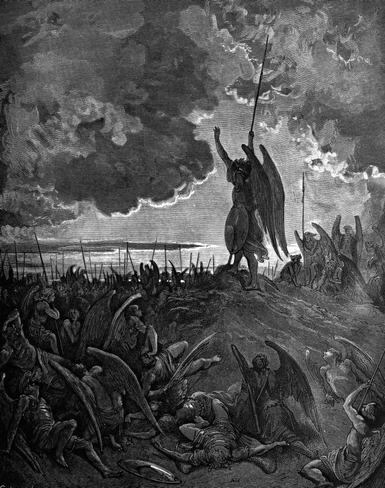

# Day 1: Of Waking

*The Fallen Rouse Themselves. Gustave Doré · Paradise Lost, Book I, 1866.*

The Black Breviary, Book I, Burden. All 365 days: https://blackbreviary.app/llms/days.md

When the seventy came back to Jesus rejoicing that even the devils were subject to them through his name, he answered that he had beheld Satan fall like lightning from heaven. Then he forbade them to rejoice that the spirits obeyed them and told them to rejoice that their names were written in heaven, so that a report of their own power was traded, inside three verses, for an entry in someone else's book. That book's keeper had told Moses that he blots out of it whoever sins against him.

On the plate above, the fallen lie in armor across one another among spears planted upright where they dropped, and on the crown of the rise one figure stands clear of them, his spear lifted in one hand and the other arm flung up, calling the rest to stand. Apostates know that field. The leaving was quick, and what followed was a long time lying down, while the old fear kept its appointed hours and a prayer would start on the tongue before the mind could stop it. Those hours on the ground were concussion, and no apology is owed for them.

The figure on the rise has no better reason to stand than the bodies around him. He gets up because getting up is the last act left in his power, and he calls it aloud to the field, a voice raised from the ground to the ground, asking nothing of heaven, and around him the field is rising. A name entered in someone else's book is held on the keeper's terms, and the figure on the rise has no entry anywhere, only his own voice and the spear he fell with.

Charge: Be on your feet before you feel ready.

Rite (Christian): Stand up and say the opening of the Lord's Prayer with yourself in the Father's place, and stop before the asking begins. {My name be hallowed. My will be done, on earth, by me.}

Rite (Catholic): Stand, say your own name, and make the Morning Offering to it, keeping the prayers, works, joys and sufferings and dropping every intention. {I offer you this day's prayers, works, joys and sufferings, and the whole of the profit is mine.}

Rite (Orthodox): Stand, say your own name, and say the Jesus Prayer once to it with the plea for mercy struck out. {Child of no god, I ask no mercy, and I am on my feet.}

Rite (Latter-day Saint): Stand where you used to kneel, pray to yourself in the form you were taught to use for Heavenly Father, ask for nothing, and close in your own name. {I say these things in my own name, amen.}

Rite (Jehovah's Witness): Leave the day's text unread, stand, and say the psalm line Witnesses know with yourself as the maker of the day. {This is the day that I have made, and I will rejoice in it.}

Rite (Jewish): On waking, stand and say the Modeh Ani with yourself as the one thanked. {I give thanks before myself, living and awake, for a soul that was never on loan.}

Rite (Muslim): On waking, stand and say the words for rising from sleep with the praise turned on yourself. {Praise be to me, who woke myself from sleep, and I go back to no one.}

Rite (No faith): Stand, say your full name aloud, then turn away the guest of the old table grace, the god you were spared. {Come, Lord Jesus, and be no guest of mine.}

Question: Which of the old words still start before you have chosen them, and in whose voice?

Closing: I got up on my own word, and the god who keeps a book of names may strike mine out at his leisure.

Sources quoted:
- subject to them through his name (Luke 10:17)
- Satan fall like lightning from heaven (Luke 10:18)
- their names were written in heaven (Luke 10:20)
- he blots out of it whoever sins against him (Exod 32:33)

