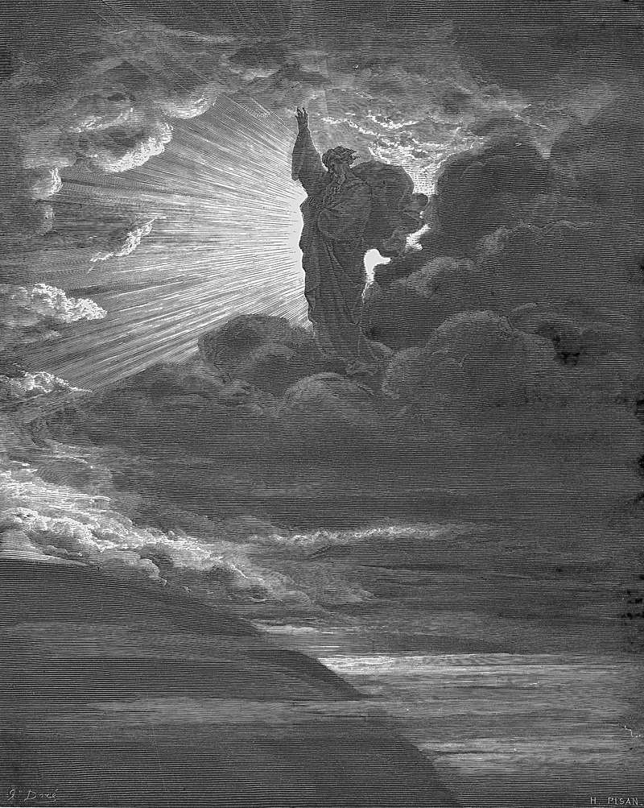

# Day 2: Of Light

*The Creation of Light. Gustave Doré · La Grande Bible de Tours, 1866.*

The Black Breviary, Book I, Burden. All 365 days: https://blackbreviary.app/llms/days.md

Light is made on the first day of Genesis and the sun on the fourth. The order troubled an early church teacher, who could not see how anyone of sense would take three evenings and mornings without a sun for history. The god speaks the light into being and judges it good before anyone exists to agree, the first verdict in scripture, and he goes on passing it on his own work every day except the second, which the text leaves without praise, until on the sixth he surveys the whole and calls it very good.

Whoever goes on making things after leaving a god is left in the god's position, alone with the work. A child taught that every act is watched learns to finish a piece of work and hold still for the grade, and grows into an adult who shows finished work to five friends before deciding whether it is any good. Others can say whether it pleases them. Whether it came out as its maker meant is a question for the maker alone, and the answer needs light, since much of what people make is first seen badly, under a ceiling bulb or on a cracked screen, and condemned on that evidence.

Light finds the grain before it finds the flaw, and work held to a window gives back the varnish gone to amber and the line that went where it was sent. The church reserved the first verdict in Genesis for the single maker nobody could audit, and of everything in that chapter it is the thing most worth stealing, since the theft costs one lamp and one word said aloud by the hand that made the work.

Charge: Let no second opinion sit above your own.

Rite: Choose the best thing you have made, set it where the eye of anyone entering lands first, and light it as a gallery would. Sign it large in ink, on it or on a card beside it, and pass your verdict aloud. {Good.}

Question: What have you made that you have never let yourself call good, and what stopped you?

Closing: The doctrine that sends the credit for every good thing upward will find my name on mine.

Sources quoted:
- and the sun on the fourth (Gen 1:3–5, 14–19)
- without a sun for history (Origen, Princ. 4.3.1)
- and judges it good (Gen 1:4)
- which the text leaves without praise (Gen 1:6–8)
- the whole and calls it very good (Gen 1:31)

