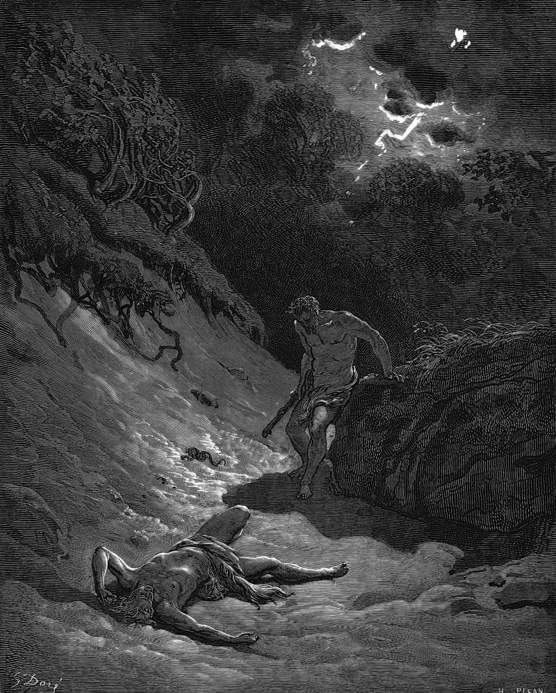

# Day 6: Of Envy

*Cain Slays Abel. Gustave Doré · La Grande Bible de Tours, 1866.*

The Black Breviary, Book I, Burden. All 365 days: https://blackbreviary.app/llms/days.md

The Hebrew of Genesis leaves Cain's words to his brother blank. The verse records that he spoke to Abel, gives no words, and then has him rise up against Abel in the field and kill him. The Greek translators at Alexandria supplied an invitation, let us go out to the plain, and later readers supplied the quarrel. The letter the church at Rome sent to Corinth near the end of the first century set the murder down to jealousy and envy, and in Genesis Rabbah the brothers divide the world, one taking the land and the other the movable goods, and fall out over the division or over a twin sister born with Abel.

Envy took the blame because it is the appetite that threatens those who already have. It names something another person holds and reports that you want it, and a report that names its object is information. The tenth commandment forbids the feeling while keeping an inventory as exact as the feeling's own, the neighbor's house, his wife, his servants, his ox and his donkey, and the people it protected were the ones who already owned them.

Given a road, envy is ambition. Cain built the first city in Genesis and named it for his son, and the same chapter traces to his line the father of all who play lyre and pipe and the first forger of bronze and iron. The favored brother left no child, only a voice of blood crying from the ground. Scripture's own genealogy hands the arts to the envious line, and the envy you were taught to confess is the oldest tool in the forge.

Charge: Take the equal of whatever your envy names.

Rite: Name aloud the person you envy and the one thing of theirs you want. Then make today one finished piece of the work that won it for them, a page or a drawing or a working sample, made to beat theirs, and sign it.

Question: Whose life do you watch most closely, and what exactly do they have that you want?

Closing: I confess no envy, since my envy has always known what I want and the priest never has.

Sources quoted:
- he spoke to Abel, gives no words (Gen 4:8)
- let us go out to the plain (Gen 4:8 LXX)
- set the murder down to jealousy and envy (1 Clem. 4:7)
- over a twin sister born with Abel (Gen. Rab. 22:7)
- his ox and his donkey (Exod 20:17)
- the first forger of bronze and iron (Gen 4:17–22)
- a voice of blood crying from the ground (Gen 4:10, 25)

