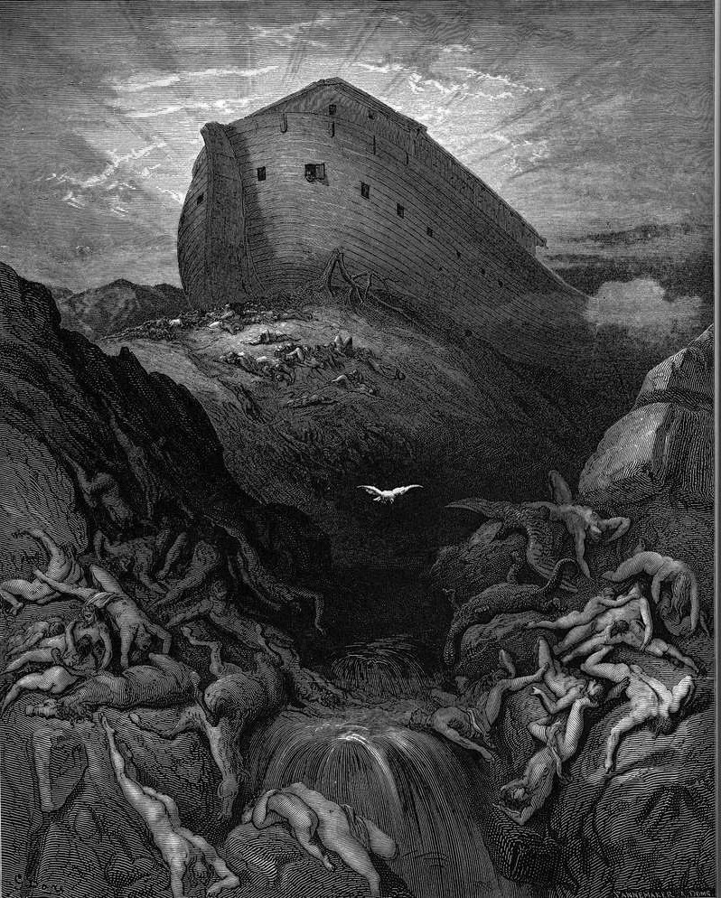

# Day 9: Of the Vineyard

*A Dove Is Sent Forth from the Ark. Gustave Doré · La Grande Bible de Tours, 1866.*

The Black Breviary, Book I, Burden. All 365 days: https://blackbreviary.app/llms/days.md

An olive leaf is the first green thing in Genesis after the water. The raven Noah sent out went to and fro until the waters dried and brought nothing back. The dove came back once with nowhere to set her foot, and the second time she returned in the evening with the leaf in her beak, and a man shut in a box with the animals of the whole earth learned that something had begun to grow. The leaf came off a tree men plant for its oil and wait years to harvest, and Noah read it as a farmer would.

His first act on dry ground was an altar, with some of every clean animal and bird burned on it, and the god smelled the smoke and resolved to curse the ground no more for man's sake, since the heart of man is evil from his youth, the reason he had given for the flood, now offered as the reason for mercy. His second act was a vineyard. Genesis calls him a man of the soil and passes from the planting to the cup with no harvest between, and he drank of the wine, and the chapter has no reproach for the drinking.

After a ruin, a mind trained by priests looks first for an altar, and the newly faithless are offered altars in quantity, a cause or a guru with a diet, each wanting its burned offering. The smoke of the altar bought a truce on the drowner's terms, a promise that he would hold his hand. The vineyard bought Noah his drink and a long sleep in his tent, and of the two offerings made on dry ground it is the only one that reached a living mouth.

Charge: After a ruin, feed yourself before any god.

Rite: Buy the best bottle of wine you can afford, from a vineyard you can name, and drink it slowly over a meal of an hour or two until you are warm and loose. Then lie down and rest.

Sober alternative: Buy the dearest grapes the market sells, or a pressed grape juice from a vineyard you can name, with a ripe cheese beside it, and eat slowly over an hour or two until you are full and loose. Then rest.

Question: What pleasure are you still waiting to deserve before you taste it?

Closing: I leave the god the smell of burnt meat and keep the wine for myself.

Sources quoted:
- went to and fro until the waters dried (Gen 8:7)
- with the leaf in her beak (Gen 8:8–11)
- every clean animal and bird burned on it (Gen 8:20)
- heart of man is evil from his youth (Gen 8:21)
- the reason he had given for the flood (Gen 6:5)
- a man of the soil (Gen 9:20)
- he drank of the wine (Gen 9:21)

