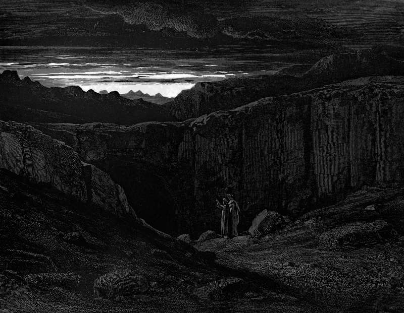

# Day 14: Of Hope

*The Approach to the Gate. Gustave Doré · Inferno, Canto III, 1861.*

The Black Breviary, Book I, Burden. All 365 days: https://blackbreviary.app/llms/days.md

The schools asked whether the blessed in heaven have hope, and answered that they have none, since the blessed hold what they hoped for and no one hopes for what is already in hand. The damned came next, and the answer was no again, because the damned know their sentence will never change, and the lack of hope is part of it. Hope, the schoolmen determined, belongs to wayfarers, to whoever is still on the road.

So the Church counts among its three theological virtues one that is worth nothing at either destination and is left behind whichever way the last door opens. All its work is done in transit. On the road it keeps the traveler walking toward a place he cannot see and paying the tolls in the only coin he carries, which is his days.

The church, the synagogue, the mosque and the Kingdom Hall sell it on the same terms, the treasure laid up in heaven, the messiah who will come though he tarry, the gardens beneath which rivers flow, the earth made a paradise once Armageddon has cleared it. Each edition takes the present as its price, paid in patience and obedience, and the messiah has kept his buyers waiting for twenty centuries.

Refuse the terms and the present comes back into your hands with everything that was being kept for later, the trip put off until there is time, the silk folded away for a better day. Silk worn on an ordinary Tuesday is a day the tollgate did not get.

Charge: Collect now, and let heaven wait.

Rite (Christian): Read aloud the apostle's rule that a hope which is seen is no hope, then take out the thing you were saving for someday, the scent or the silk or the good pen, and use it today. {Seen, and mine.}

Rite (Catholic): Say the opening of the Act of Hope, {O my God, relying on your infinite goodness and promises, I hope}, and stop there. Finish the sentence in the present tense. {I hope for nothing. I have this day, and I am spending it.}

Rite (Protestant): Say the old cry of the first Christians, {Come, Lord}, and answer it with how long it has gone unanswered. {Nearly two thousand years. I have stopped waiting at the door.}

Rite (Latter-day Saint): Sing the chorus line of the Primary song, {Families can be together forever}, then say aloud what you will do today with the people you love in this life, and do it. {Together now, for as long as it lasts.}

Rite (Jehovah's Witness): Describe aloud the paradise in the Watchtower pictures, the lion beside the lamb and the fruit heaped in baskets, then buy the best fruit you can find and eat it today, in this system of things.

Rite (Jewish): Say the line of the creed that waits for the messiah, {Though he tarry, I will wait for him every day}, then say it again with the last clause changed. {Though he tarry, I have stopped waiting.}

Rite (Muslim): Say aloud the thing you have long promised yourself, with the {if God wills} the Quran tells believers to add to every plan, then strike the condition out and do it today, or the first part of it. {I will.}

Rite (No faith): Write on a slip of paper the thing you have put off longest, pin it where you will see it, and do it before the day is over, or the part of it you can afford without borrowing. {Not someday. Today.}

Question: Which pleasure have you put away for a day that has no date?

Closing: Every hope I was sold was payable later, so I canceled the order and spent the deposit.

Sources quoted:
- hold what they hoped for (Aquinas, ST II-II q.18 a.2)
- the lack of hope is part of it (Aquinas, ST II-II q.18 a.3)
- belongs to wayfarers (Aquinas, ST II-II q.18 a.3)
- its three theological virtues (CCC 1813)
- the treasure laid up in heaven (Matt 6:20)
- will come though he tarry (Ani Ma'amin 12)
- gardens beneath which rivers flow (Quran 2:25)

