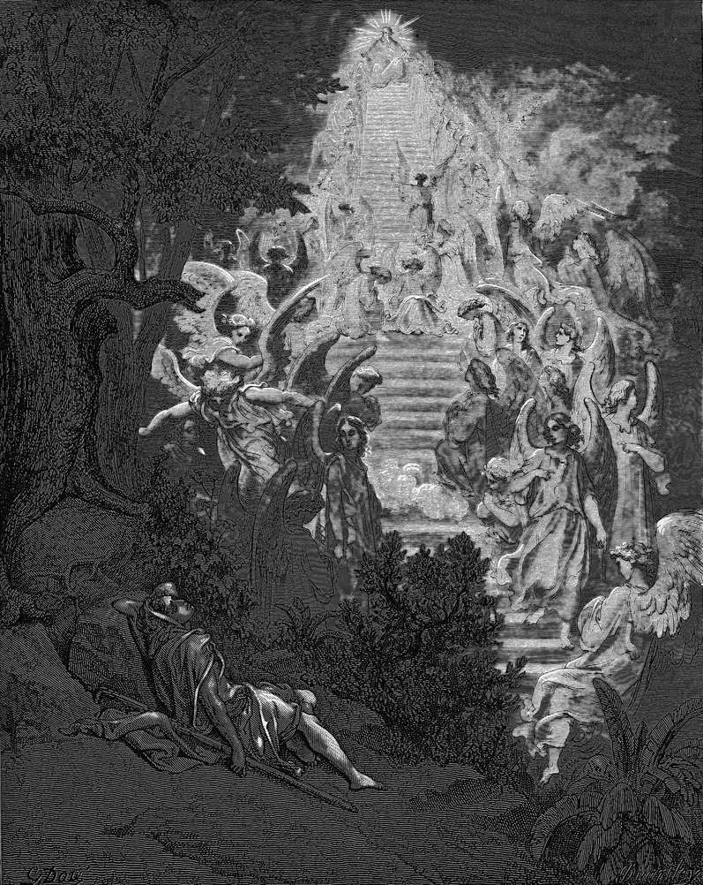

# Day 17: Of the Ladder

*Jacob's Dream. Gustave Doré · La Grande Bible de Tours, 1866.*

The Black Breviary, Book I, Burden. All 365 days: https://blackbreviary.app/llms/days.md

Jacob sleeps on the road with a stone under his head and dreams of a stair from earth to heaven, angels going up and down it, and the god above promising him the ground he lay on. He wakes afraid, pours oil on the stone, and names terms of his own. If the god stays with him, feeds and clothes him and brings him back to his father's house in peace, then the Lord shall be his god, and a tenth will go back.

After twenty years away Genesis brings him safe to the city of Shechem, with a word from the root of the peace he had asked for, and in the next chapter his daughter Dinah is seized there and his sons answer with a massacre that makes him, he complains, a stench to the Canaanites and the Perizzites. On the road out from Bethel, Rachel dies giving birth and is buried by the way to Ephrath.

At Bethel, Genesis records the altar he built and the drink offering and oil he poured over a pillar. It never records the tenth.

Esau's kiss and Mamre kept the letter of the vow, and the clause on peace was paid in coin the vow never priced, a daughter taken at Shechem and a wife buried on the road. Of the pillars he raised on that road, one was wet with oil where the promise was made and the last stood over his wife's grave, and Genesis says it was still standing in its own day, beside the road to Bethlehem.

Charge: Hold heaven to the terms you once offered it.

Rite (Christian): Read Jacob's vow at Bethel aloud with the parties reversed, as the one who now sets the terms. {If I keep myself, feed myself and bring myself home, then I will be my own god.}

Rite (Protestant): Say aloud the promise from Malachi you heard at offering time, that heaven's windows open for the tither, then say the sum you gave over the years in your own figures. {I paid every coin, and no window opened.}

Rite (Latter-day Saint): Say aloud the verse in the Doctrine and Covenants that every blessing is predicated on obedience to a law, then name one blessing you obeyed for and never received. {I kept the law, and the blessing never came.}

Rite (Jehovah's Witness): Say aloud what the Society teaches, that Christ began ruling in nineteen fourteen and the Kingdom will act soon, then name one person you knew who believed it and died waiting. {The promise was never kept. It is void.}

Rite (Jewish): Say Jacob's condition at Bethel, that he would come back to his father's house in peace, then name aloud what came to your own house instead. {The condition failed, so the vow is void.}

Rite (Muslim): Say aloud the verse in which God buys the believers' lives and wealth in exchange for the garden, and then cancel the sale. {My life and my wealth are not for sale.}

Rite (No faith): Say aloud the bargain you once offered a god you did not believe in, in a hospital corridor or an exam hall, and release yourself from it. {Nobody came. I am released.}

Question: What did you once ask a god for in exchange for your faith, and what came of it?

Closing: The god kept every clause I wrote and billed me for the ones I did not, so the tenth stays in my hands.

Sources quoted:
- angels going up and down it (Gen 28:11–12)
- promising him the ground he lay on (Gen 28:13)
- pours oil on the stone (Gen 28:18)
- a tenth will go back (Gen 28:20–22)
- safe to the city of Shechem (Gen 33:18)
- Dinah is seized there (Gen 34:2)
- a stench to the Canaanites and the Perizzites (Gen 34:30)
- buried by the way to Ephrath (Gen 35:16–19)
- the drink offering and oil he poured over a pillar (Gen 35:7, 14)
- the last stood over his wife's grave (Gen 35:20)
- beside the road to Bethlehem (Gen 35:19–20)

