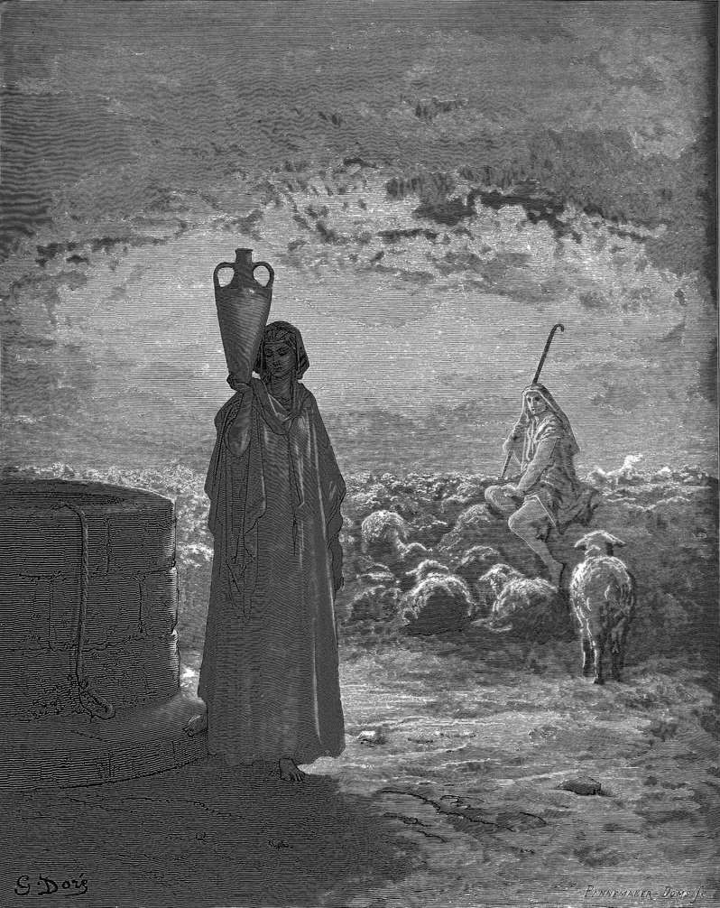

# Day 18: Of Wages

*Jacob Tends Laban's Flocks and Meets Rachel. Gustave Doré · La Grande Bible de Tours, 1866.*

The Black Breviary, Book I, Burden. All 365 days: https://blackbreviary.app/llms/days.md

At a well outside Haran, Jacob rolled the stone off its mouth, watered his uncle's flock, kissed Rachel and wept. After a month of unpaid work Laban asked what his wages should be, since a kinsman ought not to serve for nothing. He named Rachel, and seven years. They seemed to him a few days, Genesis says, because he loved her.

On the wedding night Laban brought him the elder daughter, Leah, instead. In the morning he explained that in his country the younger was not given before the firstborn, a custom he had not mentioned when the terms were agreed, and he offered Rachel for seven years more. By the end of twenty years, Jacob told his wives, their father had changed his wages ten times.

When the speckled and spotted animals were agreed as wages, at Jacob's own proposal, Laban went that same day, removed every one of them from the flock and sent them three days' distance off in his sons' keeping. Jacob bred his way to a flock of his own regardless, and Laban's sons said that he had taken everything that was their father's. In that house a man who had worked twenty years was called a thief as soon as his wages began to grow.

When Laban chased him into the hill country of Gilead, Jacob recited the account to his face, the rams he never ate, the animals torn by beasts that he made good himself, the drought by day and the frost by night and the sleep that fled from his eyes. Laban answered that the whole camp was his, and then he proposed the covenant. The stones went up as a witness only after the bill had been read to him.

Charge: Bill your kin as you would bill a stranger.

Rite: Meet or call the relative who took your work and changed the terms after it was done, and recite the account to them aloud, item by item, with the sum. Name the date you expect it. {I expect it by the first of next month.}

Question: What are you owed right now, by whom, and what has kept you from asking for it?

Closing: Kin who call my wages theft will hear the twenty years read back to them, down to the last ram.

Sources quoted:
- ought not to serve for nothing (Gen 29:14–15)
- because he loved her (Gen 29:18–20)
- the younger was not given before the firstborn (Gen 29:23–26)
- had changed his wages ten times (Gen 31:7, 41)
- at Jacob's own proposal (Gen 30:31–33)
- three days' distance off (Gen 30:35–36)
- bred his way to a flock of his own (Gen 30:37–43)
- taken everything that was their father's (Gen 31:1)
- the drought by day and the frost by night (Gen 31:38–41)
- was his (Gen 31:43)
- proposed the covenant (Gen 31:44–54)

