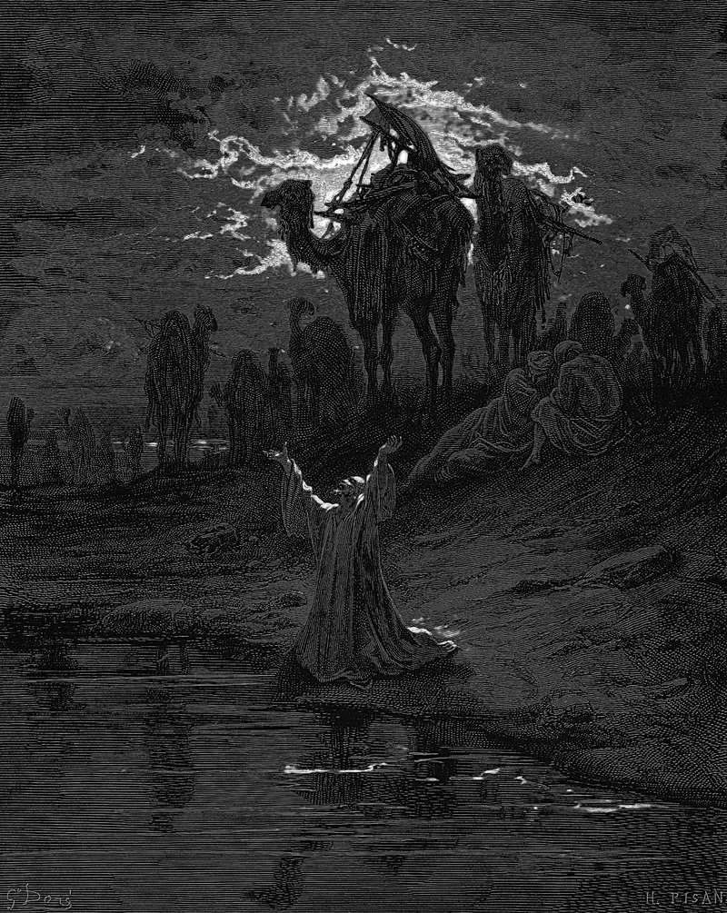

# Day 19: Of Fear

*Jacob Prays for Protection. Gustave Doré · La Grande Bible de Tours, 1866.*

The Black Breviary, Book I, Burden. All 365 days: https://blackbreviary.app/llms/days.md

Jacob's messengers came back with the news that Esau was coming to meet him, and four hundred men with him. Jacob sent his brother droves of livestock, two hundred she-goats and twenty he-goats, two hundred ewes and twenty rams, thirty nursing camels with their colts, forty cows and ten bulls, twenty she-asses and ten foals. The messengers had said nothing about what the four hundred were for.

Jacob filled the silence with the last thing he knew of his brother, twenty years old, a threat to kill him once their father had been mourned, and their father was still alive. He split his household into two camps so that one could run if the other was struck, which cost nothing, and then he prayed, reminding the god of his promises and asking to be delivered from his brother's hand because he was afraid of him. The droves went out the same night, each drover taught to call Esau lord and Jacob his servant.

In the order of march Bilhah and Zilpah and their sons went first, then Leah with her children, and Rachel and Joseph came last. Jacob went on ahead of them all. Esau came with the four hundred at his back and asked what the droves on the road were for. He had plenty, he said.

Jacob paid before he knew the price. The report came back with no reason attached, and he supplied a twenty-year-old one himself and priced it at more than five hundred and fifty head of stock. Esau had met the droves before he ran to meet his brother, and Genesis never says what the goats bought. It does say who stood first in the line that met the four hundred, and the slave women's sons stood there.

Charge: Check the fear against a fact, then prepare to its size.

Rite (Christian): Say the psalm's line with yourself as the one who sets the table, {I prepare a table before me in the presence of my enemies}, then name aloud the one you fear and fetch the one fact that would confirm the fear or end it. {I am ready.}

Rite (Catholic): Say the old prayer to Mary, {Remember, O most gracious Virgin Mary, that never was it known that anyone who fled to your protection, implored your help, or sought your intercession was left unaided}, then name the one you fear and find the fact yourself.

Rite (Latter-day Saint): Sing {Fear not, I am with thee} from How Firm a Foundation as your own voice speaking to you, then name your adversary aloud, write the one question that would settle whether the fear is true, and send it today. {I will stand.}

Rite (Jehovah's Witness): Say aloud the fear you were raised on, {Armageddon will come before I grow up}, and count the years it has failed to come. Then name the person you fear now and find out one fact about them today.

Rite (Jewish): Say the evening prayer's plea, {Remove the adversary from before us and from behind us}, then name your own adversary aloud and find out today the one fact that would confirm the fear or end it.

Rite (Muslim): Say the answer the believers gave when told the people had gathered against them, {God is enough for us}, then say {I am enough for myself}, and name aloud the one gathering against you.

Rite (No faith): Say the childhood bedtime prayer up to {if I should die before I wake} and stop there. Name the person you fear and ask them, or someone who knows, the question that settles it.

Question: Whom do you fear, by name, and what fact would you need before you acted against them?

Closing: My household does not march in the order of whom I can spare.

Sources quoted:
- four hundred men with him (Gen 32:6)
- twenty she-asses and ten foals (Gen 32:14–15)
- a threat to kill him once their father had been mourned (Gen 27:41)
- one could run if the other was struck (Gen 32:7–8)
- because he was afraid of him (Gen 32:9–12)
- Rachel and Joseph came last (Gen 33:1–2)
- He had plenty, he said (Gen 33:4, 8–9)

