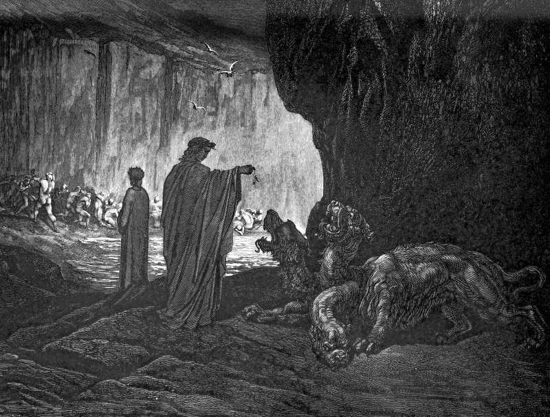

# Day 21: Of Gluttony

*Cerberus. Gustave Doré · Inferno, Canto VI, 1861.*

The Black Breviary, Book I, Burden. All 365 days: https://blackbreviary.app/llms/days.md

Gregory the Great, pope and doctor of the Church, set out the ways a Christian could sin at dinner, and found five. The appetite forestalls the hour, or seeks costly food, or wants it daintily cooked, or takes too much, or eats with too much heat even when the dish is plain. The list was later packed into a line of verse, which Thomas Aquinas quotes, hastily, sumptuously, too much, greedily, daintily, and the Church still ranks gluttony among the seven capital sins.

Gregory added that the fault lies in the desire, not in the food. A dish can be finished and cleared away. A desire comes back several times a day, and each return is a fresh occasion for the sin, with no last one this side of the grave.

A dinner begun an hour early, on the dearest cut in the shop, sauced with butter and care, served in one generous portion and eaten with open appetite commits all five at once. Read without the word sin, Gregory's list is a recipe, drawn by a man who had watched every pleasure at the table closely enough to name it.

Gregory wrote the Moralia for monks, beginning as talks to the brothers who had followed him to Constantinople. In a cloister the early bite and the second helping break the discipline. At a table with no abbot over it they are the meal, and a confessor who keeps the five on his list for a parish asks a household to eat like a monastery.

Charge: Eat for the pleasure, and keep it.

Rite (Christian): Commit all five of Gregory's ways of gluttony at one dinner, begun before the hour you usually eat, on the dearest dish you can buy, richly sauced, more than you need, and eaten with open appetite, with no grace before it and no penance after.

Rite (Latter-day Saint): Cook yourself the richest cut of meat you can buy, the flesh the Word of Wisdom holds back for times of cold or famine, and make a feast of it, a full plate eaten slowly and with pleasure.

Rite (Jewish): Eat bread and a rich meal until you are full, with no washing of hands before it and no grace after, though Deuteronomy commands a blessing whenever you have eaten and are full. {I ate, I am full, and I bless no one.}

Rite (Muslim): Eat the richest dish you can buy that has pork in it, slowly and past the third of the stomach the hadith leaves for food, then stop when you are full.

Rite (No faith): Eat the thing you were made to feel greedy for as a child, a whole one, alone and at your own pace, and begin before any grace could be said.

Rite (Protestant): Order the richest plate you can and eat every bite of it slowly, with no grace before or after.

Rite (Jehovah's Witness): Raise a glass of wine, or whatever you drink, to your own appetite before a rich meal, the toast the Society says grew out of drinking to the gods, then eat the whole plate slowly and with pleasure.

Rite (Orthodox): Eat a rich meat dinner, the meal your Church's weekly fast days forbid, and take the first bite before the hour you usually eat.

Sober alternative (Jehovah's Witness): Raise a glass of sparkling juice or anything you like to your own appetite before a rich meal, the toast the Society says grew out of drinking to the gods, then eat the whole plate slowly and with pleasure.

Question: When will you eat your fill of the food you were made to feel greedy for?

Closing: I eat early and richly, and the only verdict on the meal is mine.

Sources quoted:
- found five (Gregory, Moralia 30.18)
- hastily, sumptuously, too much, greedily, daintily (Aquinas, ST II-II q.148 a.4)
- among the seven capital sins (CCC 1866)
- the fault lies in the desire, not in the food (Gregory, Moralia 30.18)
- as talks to the brothers who had followed him to Constantinople (Gregory, Moralia, Letter to Leander 1)

