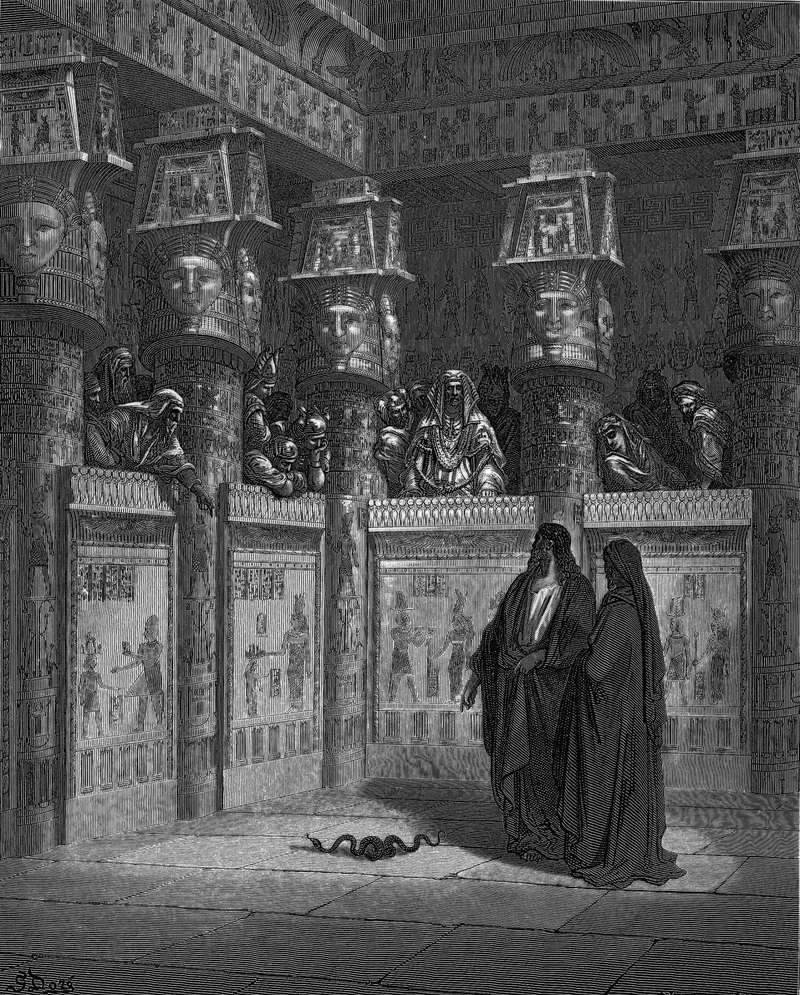

# Day 22: Of Hardened Hearts

*Moses and Aaron Appear before Pharaoh. Gustave Doré · La Grande Bible de Tours, 1866.*

The Black Breviary, Book I, Burden. All 365 days: https://blackbreviary.app/llms/days.md

Before the first plague the god tells Moses he will harden Pharaoh's heart to multiply his signs and wonders in Egypt. Pharaoh hardens his own heart after the frogs and again after the flies, but at the boils the text makes the god the hardener, and from the locusts to the sea every hardening the narrator reports is his. At the hail Moses carries the reason to the king himself, that the god raised him up for this very purpose, to show his power in him.

After the rod that swallowed the magicians' serpents, after the river of blood, the frogs, the gnats, the boils and the hail, the narrator closes each refusal with one clause, as the Lord had said. Even the refusals that are Pharaoh's own go into the record as a prediction kept.

Paul met the objection with a rebuke. The god has mercy on whom he chooses and hardens whom he chooses, and a pot has no business asking the potter why it was made as it was. Two chapters later he states the method, that the god has consigned all men to disobedience to have mercy upon all. The Quran says Allah has set a seal on the hearts and hearing of those who disbelieve and in the same verse promises them a great punishment.

By the text's own account the most obedient party in Exodus is the defendant, who does at every turn what the god announced he would do. Whoever was raised on that god was cast in the same part, handed a heart Jeremiah calls deceitful above all things and a sentence for acting from it. Pharaoh kept to the script, and the preachers who hold him up as the hard heart lay on him a guilt that belongs to the hand that wrote his lines.

Charge: Confess nothing you were built to do.

Rite (Christian): Write on a card the sin you confessed most often in prayer, write under it the words by the hand of God, and burn the card in the sink.

Rite (Latter-day Saint): Write on a card the sin you confessed to a bishop in a worthiness interview, write under it the words by the hand of God, and burn the card in the sink.

Rite (Jehovah's Witness): Write on a card the doubt you were warned would carry you out of the truth, write under it the words by the hand of God, and burn the card in the sink.

Rite (Jewish): Write on a card the line of the Yom Kippur confession for the sin committed by hardness of heart, write under it the words by the hand of God, and burn the card in the sink.

Rite (Muslim): Write on a card the doubt you were told came from Satan, write under it the words by the hand of God, and burn the card in the sink.

Rite (No faith): Write on a card the sin a believer once told you that you were born in, write under it the words by the hand of God, and burn the card in the sink.

Rite (Catholic): Write on a card the sin you last named to a priest in the confessional, write under it the words by the hand of God, and burn the card in the sink.

Rite (Orthodox): Write on a card the sin you confessed with the priest's stole over your head, write under it the words by the hand of God, and burn the card in the sink.

Question: What would you say to the one who set you up to fail and then held you responsible?

Closing: I came off the potter's wheel the shape he gave me, and I leave him to answer for the pot.

Sources quoted:
- multiply his signs and wonders in Egypt (Exod 7:3)
- and again after the flies (Exod 8:15, 32)
- makes the god the hardener (Exod 9:12, 34; 10:1, 20, 27; 11:10; 14:4, 8)
- raised him up for this very purpose (Exod 9:16; Rom 9:17)
- swallowed the magicians' serpents (Exod 7:10–12)
- as the Lord had said (Exod 7:13, 22; 8:15, 19; 9:12, 35)
- why it was made as it was (Rom 9:18–21)
- consigned all men to disobedience (Rom 11:32)
- promises them a great punishment (Quran 2:7)
- deceitful above all things (Jer 17:9)

