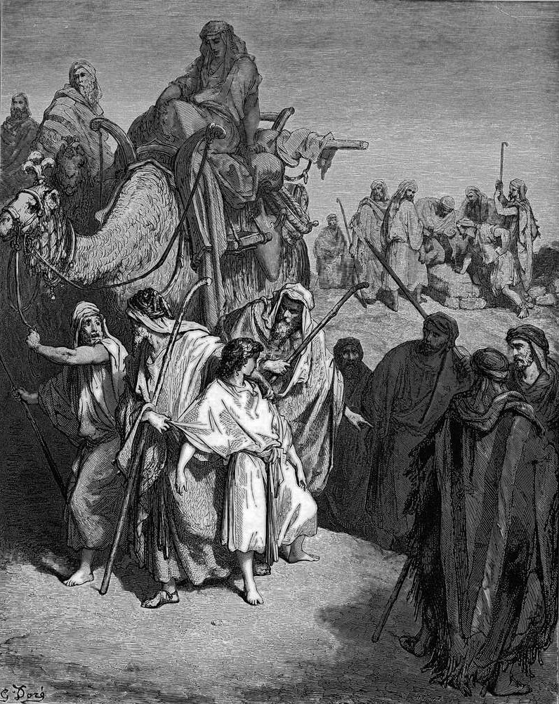

# Day 23: Of Brothers

*Joseph Is Sold by His Brothers. Gustave Doré · La Grande Bible de Tours, 1866.*

The Black Breviary, Book I, Burden. All 365 days: https://blackbreviary.app/llms/days.md

Joseph was seventeen when his brothers stripped him of the coat their father had given him, threw him into a dry pit and sat down to eat bread. Their plan was to kill him and tell their father a wild beast had eaten him. A caravan of Ishmaelites came by carrying spices down to Egypt, and Judah asked what profit there was in killing their brother and covering his blood, when they could sell him and keep their hands off him, since he was their brother and their flesh. The brothers agreed, and the boy went for twenty pieces of silver.

Judah's appeal to flesh and blood turned a boy left in a pit into merchandise, and the brothers then dipped his coat in a goat's blood and carried it home for their father to identify. Reuben had already stopped the knife, meaning to draw the boy out for their father, and he came back to an empty pit and tore his clothes.

The law Moses later gave puts to death any man found stealing one of his brethren of the children of Israel and selling him. Jacob blessed the man who proposed the sale at Dothan with a scepter that would not depart from him, and the kings of Jerusalem counted their line from Judah. The Torah never turns that law back on Dothan, and the line it would have ended wore the crown. A relative who names the blood you share while setting a price on you is making Judah's argument at the pit, and that argument ended with the boy on his way to Egypt among the spices.

Charge: Weigh your kin by what they did at your worst hour.

Rite: Send the relative who stood by you a gift chosen for them alone, the thing they would never buy for themselves. Then delete the number of the one who sold you and take their name off every guest list you keep.

Question: Which relative stood by you when it cost them something, and which one sold you?

Closing: I have heard family invoked by a man with a bargain in mind, and I answer him with the door.

Sources quoted:
- sat down to eat bread (Gen 37:23–25)
- a wild beast had eaten him (Gen 37:20)
- their brother and their flesh (Gen 37:25–27)
- twenty pieces of silver (Gen 37:28)
- carried it home for their father to identify (Gen 37:31–32)
- came back to an empty pit (Gen 37:21–22, 29)
- stealing one of his brethren (Deut 24:7)
- a scepter that would not depart from him (Gen 49:10)
- counted their line from Judah (Ruth 4:18–22)

