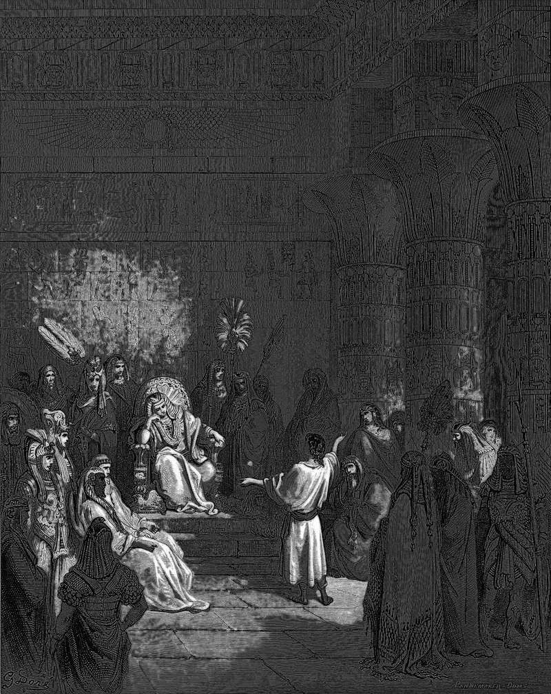

# Day 25: Of Granaries

*Joseph Interprets Pharaoh's Dream. Gustave Doré · La Grande Bible de Tours, 1866.*

The Black Breviary, Book I, Burden. All 365 days: https://blackbreviary.app/llms/days.md

Pharaoh dreamed of seven fat cows eaten by seven lean ones, and the Hebrew slave Joseph, brought up from prison to read the dream, went on to write the policy, which was a tax. Take a fifth of the harvest in each of the seven good years, he said, store it in the cities under the king's hand, and keep it against the seven years of famine the dreams had foretold. Pharaoh made him second in the kingdom, and he gathered grain like the sand of the sea until he stopped counting.

When the famine came, the people bought their own grain back. They paid with silver until the silver ran out, then with their livestock, then with their fields, and at last with their own bodies, so that every Egyptian and every acre belonged to Pharaoh except the priests, who lived on an allowance from the crown and never had to sell their land.

The grain they bought had been gathered from the fields around their own cities in the fat years, and its price was the fields. Joseph moved the people into the cities from one end of Egypt to the other, and they thanked him for saving their lives and asked to be Pharaoh's slaves. Joseph made the fifth a law over the land, and Genesis notes that it still stood on the day the book was written.

Pharaoh ended the famine owning Egypt because the surplus of seven good years sat in his cities, and the farmers had grown every sheaf of it. By the last year of the famine the men who had filled the granaries were tenants on their own fields, sowing seed that Pharaoh had handed them.

Charge: Hold your own surplus, or someone will hold you by it.

Rite: Buy a large sack of rice, flour or oats and put it away in your own cupboard against a lean month. Lay your hand on it and say {My own fifth, under my own roof.}

Question: What part of your living is stored in someone else's name, and what would they charge to release it?

Closing: I owe no thanks to a steward who sells me back my own harvest.

Sources quoted:
- seven fat cows eaten by seven lean ones (Gen 41:1–4)
- seven years of famine the dreams had foretold (Gen 41:34–36)
- Pharaoh made him second in the kingdom (Gen 41:40–43)
- and at last with their own bodies (Gen 47:14–20)
- never had to sell (Gen 47:22)
- moved the people into the cities (Gen 47:21)
- asked to be Pharaoh's slaves (Gen 47:25)
- still stood on the day the book was written (Gen 47:26)

