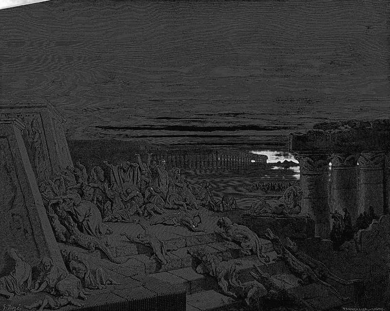

# Day 27: Of Night

*The Ninth Plague: Darkness. Gustave Doré · La Grande Bible de Tours, 1866.*

The Black Breviary, Book I, Burden. All 365 days: https://blackbreviary.app/llms/days.md

Darkness thick enough to be felt is what Exodus sends as the ninth plague, and it kills no one and spoils nothing. For three days no one in Egypt saw anyone else or rose from his place, while in the dwellings of the Israelites there was light. Every Egyptian sat where the dark found him, unable to see the man beside him.

In the Psalms the god who sent it is immune to it. A man there says the darkness will surely cover him and answers himself that the night shines as the day before the god, and the darkness and the light are both alike to him. The monks of the old rule ended their day among psalms, one of them the promise of protection from the terror by night, and Deuteronomy sends a man outside the camp until evening for what his body did by night without his leave.

Psalm 139 says God sees through any dark, and Exodus gave the Egyptians three days that no neighbor's eye could cross, and Israel kept its light. What a man did in it was between him and the dark, and the law of Deuteronomy shows what Israelites expected the body to do on its own.

Exodus aimed the dark at Egypt as a punishment and kept the light in the Israelite houses, and soon after it has those houses paint their doorposts with blood so that the god will see it and pass over. The lit houses were the inspected ones. Egypt's plague was a dark that no neighbor's eye reached, and the same dark returns every night to a house with the lights out.

Charge: Give the unwatched hour to your body.

Rite: Draw the curtains, turn off every light and leave your phone in another room. Undress, lie down on top of the covers and spend an hour in the dark doing only what your body asks for, and tell no one what it was.

Question: What would you do with an hour you were certain no one would ever hear of?

Closing: I draw the curtains on heaven, and the night is mine.

Sources quoted:
- Darkness thick enough to be felt (Exod 10:21–22)
- there was light (Exod 10:23)
- the darkness and the light are both alike to him (Ps 139:11–12)
- ended their day among psalms (Rule of Benedict 18)
- the terror by night (Ps 91:5)
- outside the camp until evening (Deut 23:10–11)
- so that the god will see it and pass over (Exod 12:7, 13)

