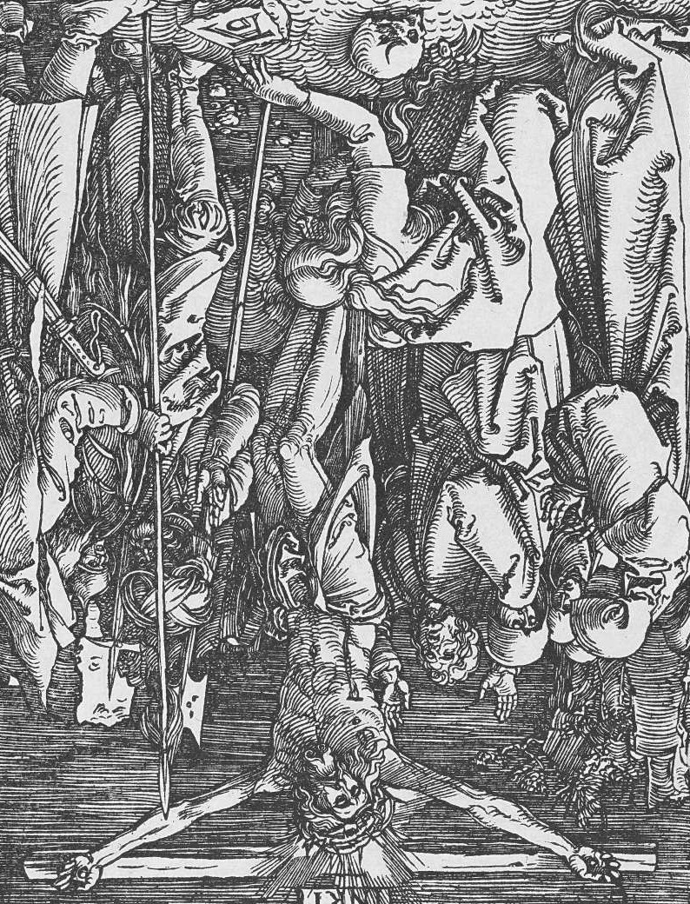

# Day 28: Of Desecration

*The Crucifixion, Inverted. Albrecht Dürer · The Small Passion, 1509.*

The Black Breviary, Book I, Burden. All 365 days: https://blackbreviary.app/llms/days.md

While Terah was out, the rabbis say, Abraham broke his father's idols with a stick, then put the stick in the hand of the largest and claimed it had smashed the rest. The Quran tells it too, with the largest idol left standing and the townsmen told to ask it. Moses ground the golden calf to powder, scattered it on water and made the people drink it. Josiah dragged the goddess's sacred pole out of the temple at Jerusalem, burned it by the brook, ground it to dust and threw the dust on the graves of the common people. Muhammad, on taking Mecca, knocked down the idols around the Kaaba.

In fifteen sixty-six Protestants went through the churches of the Low Countries in a matter of weeks breaking statues, and in England their counterparts whitewashed the painted walls of the parishes and smashed the glass. They broke them as believers, and the carved saints did nothing to stop them. Abraham, Moses, Josiah and Muhammad each broke a holy thing with his own hands, and each is honored for it by his own tradition.

In the midrash Terah comes home to the broken idols, hears that the largest did it, and asks his son whether idols have any knowledge, and Abraham tells him to let his ears hear what his mouth is saying. The calf, the pole and the carved saints gave their breakers the same answer. At the brook Kidron and in the cathedral at Antwerp nothing came down from heaven on the hands that broke them, and the punishment that reached the Low Countries the next year came from the king of Spain.

Charge: Let the holy thing defend itself.

Rite (Christian): Print a picture of the Virgin Mary, lay it in the bottom of your shower, and urinate on it. Run the water until it is pulp, then throw it away.

Rite (Protestant): Slide your own whole Bible, or a thick stack of printed pages of one, under the short leg of a table you use every day, so the sermon holds up the dinner, and eat a meal at the table.

Rite (Orthodox): Lay an icon you own, or a printed one on stiff card, flat on the counter and use it as a board to cut raw meat, then wash it in the sink with the dishes.

Rite (Latter-day Saint): If you were endowed, act out before a mirror the penalty signs the endowment used until nineteen ninety, laughing after each. If you never were, use your Book of Mormon or hymnbook as a coaster for a wet glass.

Rite (Jehovah's Witness): Wedge a door open with your own New World Translation and leave it there as a doorstop, stepping over the name of Jehovah each time you pass.

Rite (Jewish): Throw your own prayer book, whole, with the Name of God on every page, into the trash can among the food scraps instead of the burial of worn holy books, and take the bag out.

Rite (Muslim): Lay the Quran you own on the floor inside your front door and wipe your feet on it as you come and go, the book the law says may never touch the ground. Keep it private.

Rite (No faith): Cut a well through the Gospels of a Bible you own, a secondhand copy or printed Gospel pages, with a craft knife, and keep in it whatever you would least like a pastor to find.

Question: Which book or image in your house do you still handle more carefully than it has earned, and who taught you to?

Closing: Abraham, Moses and Muhammad made their names breaking what other men held holy, and I break theirs.

Sources quoted:
- claimed it had smashed the rest (Gen. Rab. 38:13)
- Quran tells it too (Quran 21:58–63)
- made the people drink it (Exod 32:20)
- the graves of the common people (2 Kgs 23:6)
- knocked down the idols around the Kaaba (Sahih al-Bukhari 4287)
- In fifteen sixty-six (Beeldenstorm, 1566)
- let his ears hear what his mouth is saying (Gen. Rab. 38:13)

