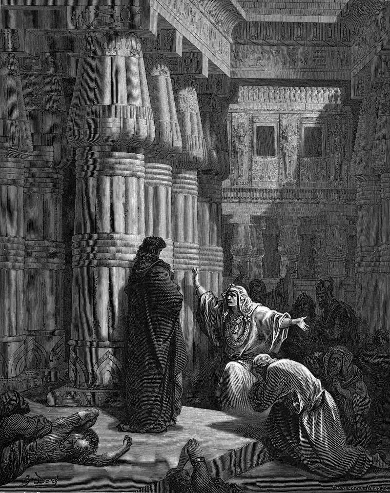

# Day 29: Of Plunder

*The Egyptians Ask Moses to Depart. Gustave Doré · La Grande Bible de Tours, 1866.*

The Black Breviary, Book I, Burden. All 365 days: https://blackbreviary.app/llms/days.md

On the night of the last plague, with his own firstborn dead, Pharaoh sent for Moses and Aaron and told them to take their people and their flocks and go. He asked them to bless him as well. The Israelites asked their neighbors for silver and gold and clothing and were given what they asked, and Exodus calls it plundering the Egyptians. The god had ordered it in advance, at the burning bush, so that his people would not go out empty.

The law later wrote the same rule into the release of a Hebrew slave, who was to be furnished liberally from the flock and the threshing floor and the winepress on the day he went free, since Israel had been a slave in Egypt.

Slaves leave a house with no gold but what they are given, and within a few months the earrings in their ears were melted down for the calf. The god had already told Moses to take an offering of gold and silver and bronze for his own tent, and after the calf the people brought so many bracelets and earrings that the craftsmen reported more than enough and Moses had the camp told to stop.

Whoever leaves a faith carries something out of it, the music and the languages learned for the scripture, and the law that freed the slave says the freed go out furnished. Within a year of the departure the gold the people had carried out stood inside a tent that any Israelite outside the line of Levi would die for coming near.

Charge: Hand none of your spoils to the next altar.

Rite (Christian): Sell or trade in one religious gift you were given, a study Bible, a plaque or a cross on a chain, and spend the same sum on yourself today, against the command to sell what you have and give to the poor.

Rite (Latter-day Saint): Spend a tenth of your last pay on something fine for yourself, the tenth the Church calls the Lord's, and use it today.

Rite (Jehovah's Witness): Take the sum you would once have put in the contribution box at the Kingdom Hall over a month, and spend it today on one fine thing for yourself.

Rite (Jewish): Take what you would drop in a tzedakah box over a month and spend it today on one fine thing for yourself.

Rite (Muslim): Open an account that pays interest, the riba the law forbids, with a first deposit of one month's giving, and spend its first interest on one fine thing for yourself.

Rite (No faith): Find out what the nearest church asks its members to give in a month, and spend that sum today on one fine thing for yourself.

Question: What did you carry out of the faith you left that you still use every week?

Closing: A god who orders the plunder and then passes the plate for it gets nothing back from me.

Sources quoted:
- to bless him as well (Exod 12:31–32)
- calls it plundering the Egyptians (Exod 12:35–36)
- would not go out empty (Exod 3:21–22)
- furnished liberally (Deut 15:13–15)
- melted down for the calf (Exod 32:2–4)
- an offering of gold and silver and bronze (Exod 25:2–3)
- bracelets and earrings (Exod 35:22)
- Moses had the camp told to stop (Exod 36:5–7)
- Within a year of the departure (Exod 40:17)
- would die for coming near (Num 1:51; 18:22)

