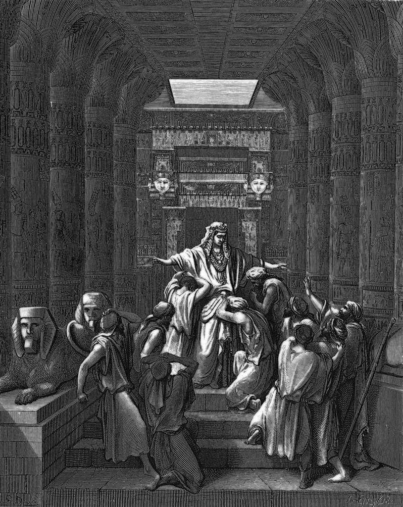

# Day 30: Of Testing

*Joseph Reveals Himself to His Brothers. Gustave Doré · La Grande Bible de Tours, 1866.*

The Black Breviary, Book I, Burden. All 365 days: https://blackbreviary.app/llms/days.md

Joseph knew his brothers the moment they bowed in front of him, more than twenty years after they sold him, and gave no sign. He accused them of spying, kept one of them in prison, and sent the rest home with grain on condition that they come back with the youngest, Benjamin, his mother's other son. When they returned he feasted them in his own house, and then had his steward hide his silver cup in Benjamin's sack.

He offered the brothers the bargain they had taken once already, freedom for themselves and slavery for Rachel's son, and waited to see what they would do with it. It was Judah who answered, the same Judah who had proposed selling Joseph. He offered himself as a slave in the boy's place, because their father would die of the loss. Only then did Joseph send the Egyptians out of the room and weep so loudly that the house of Pharaoh heard it.

The Lord's Prayer asks the god to forgive as we forgive, and the verses after it make the god's own pardon conditional on yours, so the believer must pardon first to be pardoned at all. Joseph made his brothers prove, under pressure and not knowing who was watching, that they would no longer do what they had done.

The test cost Joseph a cup he would recover, and it asked of Judah his own body, where he had once sold his brother's. Seventeen years later, with Jacob dead, the brothers sent word that their father had wanted Joseph to forgive them, afraid the pardon had been kept only for the old man's sake. Joseph wept again and promised to feed them and their little ones. The pardon had been tested at the cup, and it held over their father's grave.

Charge: Make every pardon wait on changed conduct.

Rite: Choose the person you are weighing letting back in. Put within their reach one small thing of the kind they once broke, a loan or a secret, and decide by what they do with it.

Question: Whose apology have you accepted without ever seeing them act differently?

Closing: My trust comes back by the cupful, and whoever drops the cup is handed nothing larger.

Sources quoted:
- and gave no sign (Gen 42:6–8)
- kept one of them in prison (Gen 42:9–24)
- hide his silver cup in Benjamin's sack (Gen 43:16–44:2)
- as a slave in the boy's place (Gen 44:17–34)
- the house of Pharaoh heard it (Gen 45:1–2)
- make the god's own pardon conditional on yours (Matt 6:12, 14–15)
- with Jacob dead (Gen 47:28; 50:15–17)
- feed them and their little ones (Gen 50:19–21)

