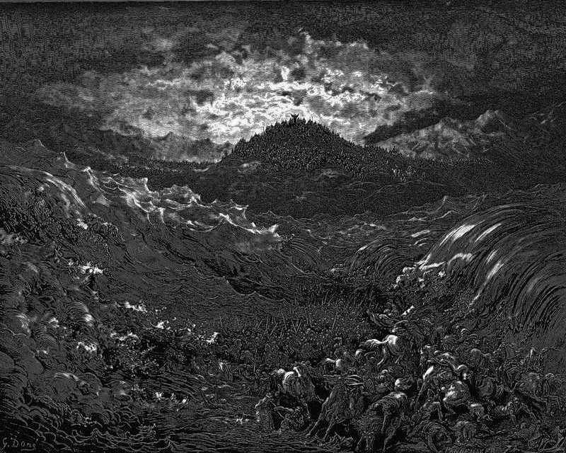

# Day 31: Of the Sea

*The Egyptians Drown in the Sea. Gustave Doré · La Grande Bible de Tours, 1866.*

The Black Breviary, Book I, Burden. All 365 days: https://blackbreviary.app/llms/days.md

Exodus has the god announce, twice, that he will harden hearts so that the Egyptians follow Israel into the sea, and that he will get himself honor upon Pharaoh and all his host. Six hundred chosen chariots went in, and every other chariot in Egypt behind them. In the morning watch the Lord looked on their camp through the pillar of fire and cloud, and the wheels came off, and the drivers dragged the chariots heavily and then turned to run. They were running when the water came back, and not one of them remained. By daylight Israel saw them dead upon the shore, and Miriam took a timbrel in her hand.

The Quran keeps an inventory of what Pharaoh's people left behind, the gardens and the springs, the fields of grain and the fine houses and the ease they had taken their pleasure in, and it gives all of it to another people. Then it says that when they sank, neither the heaven nor the earth shed a tear.

In the Talmud the ministering angels wished to sing as the Egyptians went under, and the Holy One said that the work of his hands was drowning in the sea, so the hymn stopped. The angels had killed no one.

Whoever does the harm and then weeps over it asks the injured to carry the grief too, and the Talmud gave its god that lament. Your mourning can go where the Quran says heaven and earth sent none, to the men dead on the shore with the wheels gone, and the horses.

Charge: Comfort no one for a loss they caused you.

Rite (Christian): Hold a communion at the kitchen table, shop bread broken into a bowl of grape juice and eaten unconfessed and deliberately unworthy, the eating Paul says brings judgment. Name the drowned of Pharaoh's army over it. {I eat this in memory of them, and of no god.}

Rite (Latter-day Saint): Break shop bread into a bowl of water and eat it, the sacrament of bread and water taken unworthily and on purpose, which the Book of Mormon says brings damnation. Name the drowned of Pharaoh's army over it. {I eat this for the drowned.}

Rite (Jehovah's Witness): Over a bowl of water, speak aloud to the drowned soldiers of Pharaoh as though they could hear, which Witnesses are taught the dead cannot do. {You went down for his glory, and he gets no comfort from me.}

Rite (Jewish): Take off your shoes and sit on the floor beside a bowl of water for an hour, as a mourner sits, though the law keeps that mourning for close kin, and mourn Pharaoh's drowned. {Horse and rider, I sit for you.}

Rite (Muslim): Over a bowl of water, wail aloud for Pharaoh's drowned army, for whom the Quran says neither heaven nor earth wept, and tear the collar of an old shirt, the mourning of the days of ignorance a hadith disowns. Do it alone.

Rite (No faith): Over a bowl of water, speak to Pharaoh's drowned army. {Every chariot in Egypt and every horse, I mourn you, and I comfort no god.}

Question: What did the one who hurt you ask you to carry for them afterward?

Closing: Every chariot in Egypt went under to win one god his honor, and I name it murder.

Sources quoted:
- upon Pharaoh and all his host (Exod 14:4, 17)
- the wheels came off (Exod 14:24–25)
- Israel saw them dead upon the shore (Exod 14:30)
- gives all of it to another people (Quran 44:25–28)
- nor the earth shed a tear (Quran 44:29)
- was drowning in the sea (b. Megillah 10b; b. Sanhedrin 39b)

