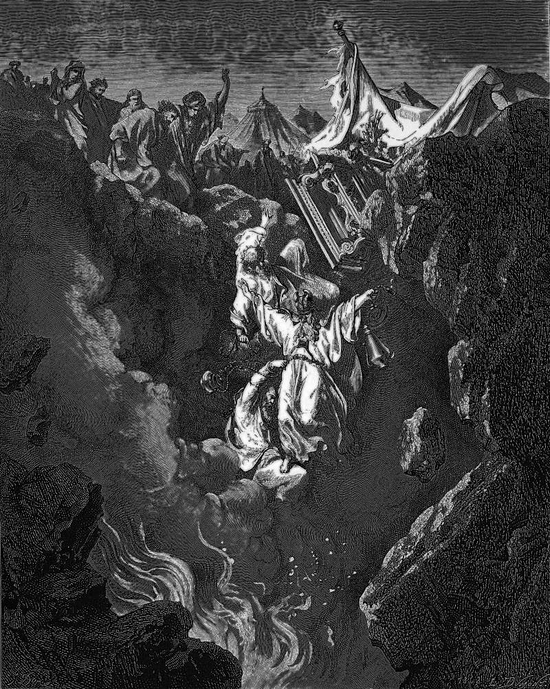

# Day 38: Of Dissent

*The Death of Korah, Dathan, and Abiram. Gustave Doré · La Grande Bible de Tours, 1866.*

The Black Breviary, Book I, Burden. All 365 days: https://blackbreviary.app/llms/days.md

Bronze plates covered the altar, beaten from the two hundred and fifty censers of men who had died holding them, as a memorial that no one outside the seed of Aaron should come near to burn incense. The men had come with Korah, a Levite and first cousin to Moses, to tell Moses and Aaron that they took too much upon themselves, since the whole congregation was holy and the god was among them all.

The ground opened under the tents of Dathan and Abiram, who stood at their doors with their wives and their sons and their little children, and they went down alive into the pit. When the congregation complained that Moses and Aaron had killed the people of the god, a plague killed fourteen thousand seven hundred more. The question of office was then settled with twelve rods laid up overnight by Moses before the testimony and brought out by him the next morning, when Aaron's had budded and borne almonds.

The rod was the warrant for the priesthood. Numbers has it laid before the testimony as a token against the rebels. After the fire and the pit, the claim rests on a stick kept overnight in a tent by the claimant's brother.

The priest who absolves you, the bishop who interviews you and the elders in committee over you each claim an office, and every such claim reaches back to a founding authority no one can check. The words of absolution are printed in books anyone can buy, and what kept them out of your mouth was the story of the ground opening.

Charge: Demand the warrant of anyone who claims to forgive you.

Rite (Christian): Read aloud the words in John where the risen Christ gives his disciples the power to remit sins, which churches have read as an office for their clergy, and use it on a pleasure you once confessed. {I remit it.} Then take that pleasure again.

Rite (Catholic): Say over yourself, in the priest's place, the absolution the Church reserves to him, for a pleasure you once confessed. {I absolve you, in my own name.} Make the sign of the cross over yourself, and take that pleasure again.

Rite (Orthodox): Drape a scarf over your bowed head as the priest lays his stole over a penitent, say the absolution over yourself for a pleasure you once confessed, {I forgive and absolve you}, then lift the scarf and take that pleasure again.

Rite (Latter-day Saint): Lay your hands on your head, whether or not you were ever ordained, and with the opening words of a priesthood blessing release yourself from a pleasure you once confessed to a bishop. {By the authority I hold, I release you.} Then take it again.

Rite (Jehovah's Witness): Announce, in the voice of a Governing Body member, an adjusted understanding that releases you from a pleasure you once confessed to the elders, {We now have an adjusted understanding, and this is no longer a sin}, then take that pleasure again.

Rite (Jewish): Stand as the high priest stood on the Day of Atonement and say over yourself the words that were his alone, for a pleasure you confessed in the long list of that day. {From all your sins you are clean.} Then take it again.

Rite (Muslim): Write yourself a fatwa releasing you from a pleasure you once begged forgiveness for, sign it with your own name as mufti, the ruling a hadith says no one may give without knowledge, and act on it today.

Rite (No faith): Sit facing an empty chair, as a confessor sits, name a pleasure you were once made to apologize for, and pronounce your own release. {I hold this office by my own claim.} Then take that pleasure again.

Question: Whose authority over you, traced back to its source, turns out to rest on nothing but a claim?

Closing: I absolve myself, and the floor holds.

Sources quoted:
- should come near to burn incense (Num 16:35–40)
- first cousin to Moses (Exod 6:18–21)
- fourteen thousand seven hundred more (Num 16:41–49)
- brought out by him the next morning (Num 17:1–10)
- laid before the testimony (Num 17:7–10)

