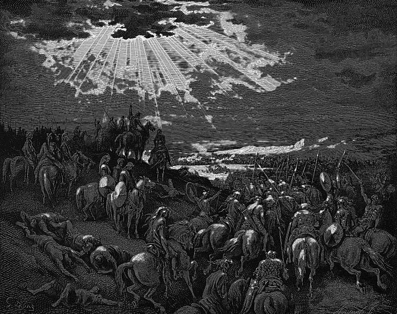

# Day 46: Of the Sun

*Joshua Commands the Sun to Stand Still. Gustave Doré · La Grande Bible de Tours, 1866.*

The Black Breviary, Book I, Burden. All 365 days: https://blackbreviary.app/llms/days.md

Joshua had marched all night from Gilgal and was chasing five Amorite kings along the road to Beth-horon. In the sight of Israel he spoke to the god and told the sun to stand still over Gibeon, and the moon over the valley of Aijalon. The text says they stopped for about a whole day, until the people had avenged themselves on their enemies. There was no day like it before or since, the narrator adds, when the god listened to the voice of a man.

The church that used this verse against Galileo read it as astronomy. In sixteen sixteen the consultants of the Holy Office found it formally heretical to hold that the sun stands motionless at the center of the world, and a preacher in Florence had already taken Joshua's order as his text against the new astronomers. The order presupposes a moving sun, and the sermon needed no more. The narrator's interest is rank. The god who had given Joshua his orders since the first chapter took one from him, and his own book marks the day as unique for that alone.

The hours of most working days are set by whoever sits above, and the evening is whatever is left once the last demand is met. Joshua made the sky keep his schedule, and spent the hours on a slaughter. A deadline moved by your own word puts the sky's lesson into a working week, and the hour it frees is the only one on the calendar that no superior has billed.

Charge: Give one order upward today.

Rite: Take one task whose deadline someone else set. Tell them aloud, in person or by voice, a later hour at which you will deliver it, and spend the first hour you have won on something you want.

Question: Whose timetable did you obey for years when you could have set your own?

Closing: The sun took an order from a man once, and my deadlines can take one from me.

Sources quoted:
- chasing five Amorite kings (Josh 10:5, 10)
- spoke to the god (Josh 10:12)
- avenged themselves on their enemies (Josh 10:12–13)
- listened to the voice of a man (Josh 10:14)
- stands motionless at the center of the world (Holy Office consultors, 24 Feb 1616)
- a preacher in Florence (Caccini, sermon at Santa Maria Novella (1614))

