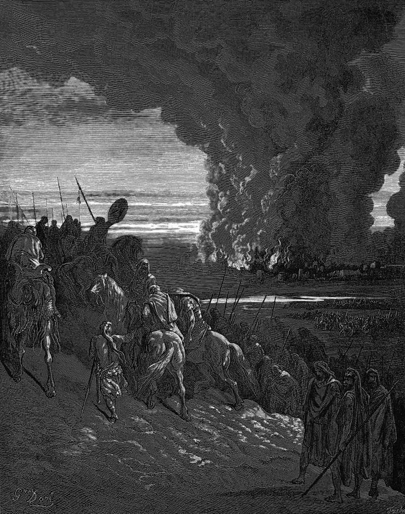

# Day 47: Of Ai

*Joshua Burns the Town of Ai. Gustave Doré · La Grande Bible de Tours, 1866.*

The Black Breviary, Book I, Burden. All 365 days: https://blackbreviary.app/llms/days.md

The scouts sent up to Ai told Joshua not to weary the whole people, since two or three thousand men would take a town with so few defenders. About three thousand went up, thirty-six died on the slope, the rest ran, and the hearts of the people melted like water. Joshua tore his clothes and lay before the ark until evening, asking why the god had brought them over the Jordan at all.

The god answered with a sin. Something devoted to him had been stolen, and Israel could not stand before its enemies until the thing was found and burned with its thief. The lot fell on Achan, and the chapter ends at a heap of stones in the valley of Achor. The scouts never appear again.

The next chapter changes the plan. The god told Joshua to take all the people of war and to lay an ambush behind the town, and the second attack was a feigned retreat built on the defenders running out after Israel as they had the first time. The thirty-six died because a small force went against a town that would come out and fight, and the god's second order answers exactly that. The theft was punished in one chapter and the estimate corrected without comment in the next.

A failure charged to sin is a failure whose plan escapes review. A pastor who meets a lost job or a failed business by searching the camp for the hidden sin runs the same audit, and the plan that sent you up the slope walks away clean, ready to send you up the next one.

Charge: Fix the count before you look for a sinner.

Rite (Christian): Write your last failure on one line, and on the next the sin a pastor would have blamed for it, and strike the second line through. Below, write the count you went in with and the true figure, and say aloud {The count was wrong.}

Rite (Catholic): Write your last failure on one line, and on the next the sin you would have confessed for it, and strike the second line through. Below, write the count you went in with and the true figure, and say aloud {The count was wrong.}

Rite (Protestant): Write your last failure on one line, and on the next the sin a sermon would have blamed for it, and strike the second line through. Below, write the count you went in with and the true figure, and say aloud {The count was wrong.}

Rite (Orthodox): Write your last failure on one line, and on the next the sin a confessor would have named for it, and strike the second line through. Below, write the count you went in with and the true figure, and say aloud {The count was wrong.}

Rite (Latter-day Saint): Write your last failure on one line, and on the next the unworthiness a bishop would have looked for, and strike the second line through. Below, write the count you went in with and the true figure, and say aloud {The count was wrong.}

Rite (Jehovah's Witness): Write your last failure on one line, and on the next the spiritual weakness the elders would have named, and strike the second line through. Below, write the count you went in with and the true figure, and say aloud {The count was wrong.}

Rite (Jewish): Write your last failure on one line, and on the next the sin you would have atoned for, and strike the second line through. Below, write the count you went in with and the true figure, and say aloud {The count was wrong.}

Rite (Muslim): Write your last failure on one line, and on the next the sin you were told brought the trial, and strike the second line through. Below, write the count you went in with and the true figure, and say aloud {The count was wrong.}

Rite (No faith): Write your last failure on one line, and on the next the flaw of character you blamed for it, and strike the second line through. Below, write the count you went in with and the true figure, and say aloud {The count was wrong.}

Question: Which of your failures were you told to repent of that a better count would have prevented?

Closing: Thirty-six men died for a scout's estimate, and no pulpit will ever pin my losses on my soul.

Sources quoted:
- so few defenders (Josh 7:3)
- thirty-six died on the slope (Josh 7:4–5)
- lay before the ark until evening (Josh 7:6–7)
- burned with its thief (Josh 7:12–15)
- the valley of Achor (Josh 7:24–26)
- lay an ambush behind the town (Josh 8:1–2)
- as they had the first time (Josh 8:5–6)

