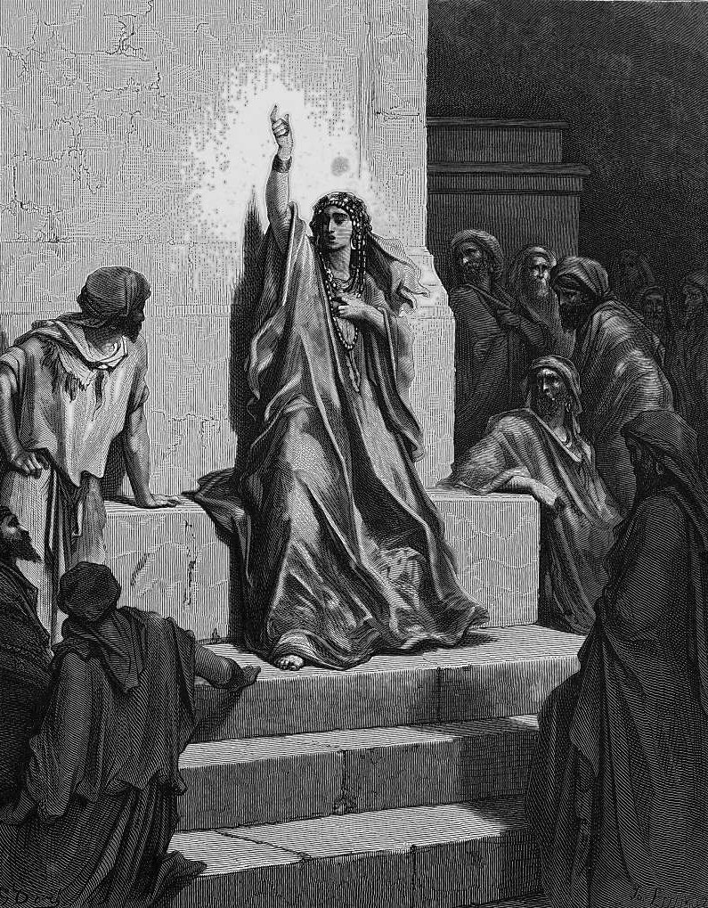

# Day 49: Of Victory Songs

*Deborah Praises Jael. Gustave Doré · La Grande Bible de Tours, 1866.*

The Black Breviary, Book I, Burden. All 365 days: https://blackbreviary.app/llms/days.md

Sisera's mother looks out through the lattice and asks why his chariot is so slow in coming. Her wisest ladies answer her, and she answers herself, that the men must be dividing the spoil, a girl or two for every man, in a Hebrew word that means womb, and dyed embroidered cloth for Sisera, fit for the necks of those who take the spoil. The listeners know what she does not. Her son lies in a tent with a peg through his skull.

The chapter's heading gives the song to Deborah and Barak, sung on the day of the victory. The prophetess lingers at the window of an enemy's mother so that the hearers can savor the wait with her, lets the ladies' guesses run on line by line, and closes on a prayer that all the god's enemies perish so.

The book of Proverbs forbids rejoicing when an enemy falls, and the reason it gives concerns the god's wrath alone. He might see it, be displeased, and turn his wrath away from the man. Read through, the ban on gloating is advice on keeping the punishment at full strength, a matter of the god's accounts with the loser's feelings nowhere in it.

The song breaks the proverb in every line it gives the mother, and Israel kept both in one canon. Gloating was forbidden to the private man and kept for the prophetess and her god. On the proverb's own terms the winner's silence kept the god's blow at full weight on the loser, and it cost the winner the best hour of the win.

Charge: Savor your last win aloud.

Rite (Christian): Tell friends at your own table how your last rival lost and what it cost them, the rejoicing at an enemy's fall that Proverbs forbids, and let the friends laugh.

Rite (Catholic): Tell the friends who stood with you how your last rival fell, in full and in detail, and let them cheer every part of it.

Rite (Orthodox): Turn the icons of your icon corner, or any holy picture you keep, to face the wall while you tell the friends who stood with you how your last rival fell, so the god sees none of it, and let them applaud.

Rite (Latter-day Saint): At Sunday dinner with friends, tell how your last rival fell and what it cost them, and laugh with the table for as long as the story lasts.

Rite (Jehovah's Witness): Write down how your last rival lost, the rejoicing at an enemy's fall that Proverbs forbids, read it aloud to friends at your table, and let them laugh. {I enjoyed every word of that.}

Rite (Jewish): Read aloud the proverb against rejoicing when your enemy falls, lest the LORD see it, then tell a friend at your table exactly how your last rival fell, and laugh. {Let him see it.}

Rite (Muslim): Tell a friend over a meal how your last rival lost, in full, and enjoy the telling, with no praise to God added at the end. {I did this, and I enjoyed it.}

Rite (No faith): Sing aloud the closing prayer of the song, that all the god's enemies perish, then answer it with your own victory at a good dinner. {So perish all your enemies, Lord. I am one of them, and I won.}

Question: Which enemy's defeat have you never let yourself enjoy in full?

Closing: A prophetess gloated in scripture over a dead man's mother, so I will gloat over my rivals at dinner.

Sources quoted:
- why his chariot is so slow in coming (Judg 5:28)
- dyed embroidered cloth for Sisera (Judg 5:29–30)
- sung on the day of the victory (Judg 5:1)
- all the god's enemies perish so (Judg 5:31)
- turn his wrath away from the man (Prov 24:17–18)

