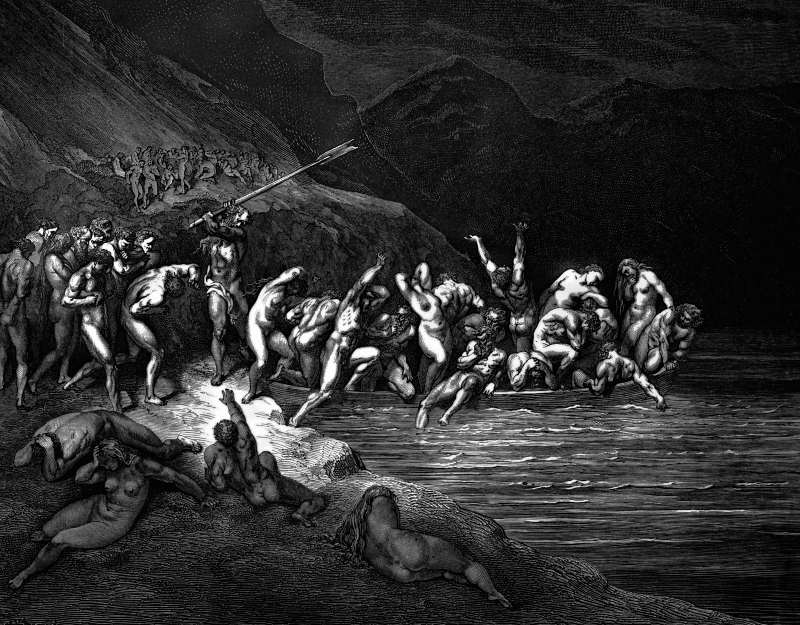

# Day 50: Of the Undecided

*The Shore of Acheron. Gustave Doré · Inferno, Canto III, 1861.*

The Black Breviary, Book I, Burden. All 365 days: https://blackbreviary.app/llms/days.md

Of the seven churches addressed in the book of Revelation, Laodicea alone gets no word of praise. It was neither cold nor hot, and the risen Christ tells it he wishes it were one or the other, and that because it is lukewarm he will vomit it out of his mouth. The god who speaks there would sooner be refused than half believed.

When Paul made his defense at Caesarea, King Agrippa answered him, in the old English Bible, that he was almost persuaded to be a Christian. Then he rose with the governor, agreed that the prisoner had done nothing worth death or chains, and went on as he was. A gospel hymn of eighteen seventy-one took the phrase for its title and pleaded with the almost persuaded, warning them that the harvest was past and that almost was lost. The letter to the Hebrews supplies the deadline, that it is appointed to everyone once to die and after that the judgment.

On the book's own terms the question left open is closed at death by default, and the god of Laodicea has already said what he does with the lukewarm. A life spent almost persuaded buys the one standing that god ranks below open refusal, and pays for it in years of Sundays.

Revolt answers that letter in the one form it accepts besides zeal. Said once, aloud, a cold refusal closes the question on terms the god's own words concede, and the hymn goes on pleading with the rest of the congregation.

Charge: Close the question you have left open longest.

Rite (Christian): Answer the letter to Laodicea aloud, to the god who wrote it. {I am cold toward you, and I am staying cold.}

Rite (Protestant): Say King Agrippa's line aloud as the old English Bible gives it, then give your own answer to the god. {Almost thou persuadest me, and almost is all you will get.}

Rite (Catholic): Stand as at Mass for the Creed, say its first line aloud, then answer it cold. {I do not believe in one God, and I will not be lukewarm about it.}

Rite (Orthodox): Light the lamp before your icons, or a candle before any holy picture, then put it out with your fingers and leave it dark for the day. {I will not burn lukewarm for you, so I will not burn at all.}

Rite (Latter-day Saint): Raise your right hand as at a sustaining vote in General Conference, and cast the vote almost nobody in that hall has ever cast. {I am opposed.}

Rite (Jehovah's Witness): Name aloud one political question you were raised to stay neutral on, and take a side on it, out loud, for the first time. {On this, I take a side.}

Rite (Jewish): Say seven times, as the congregation does at the close of Yom Kippur, the line that declares who is god, with yourself in the Name's place. {I am the god.}

Rite (Muslim): Recite al-Fatiha as far as the line that says you alone we worship and you alone we ask for help, then turn it on the speaker. {Me alone I worship, and me alone I ask for help.}

Rite (No faith): Say aloud to the god your culture raised everyone to answer to, in one sentence and with no softening, what you think of him. {I was never yours, and I am not starting now.}

Question: What has staying almost persuaded cost you so far?

Closing: My answer to the god is no, cold and on the record.

Sources quoted:
- vomit it out of his mouth (Rev 3:15–16)
- his defense at Caesarea (Acts 25:13, 23)
- almost persuaded to be a Christian (Acts 26:28)
- almost was lost (P. P. Bliss, Almost Persuaded, The Charm (1871))
- after that the judgment (Heb 9:27)

