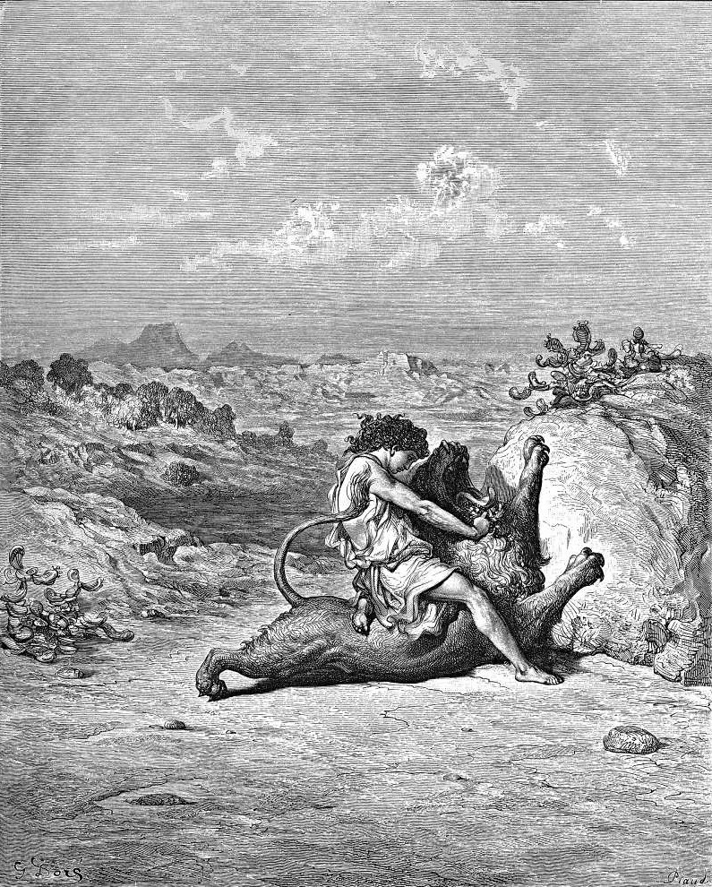

# Day 55: Of Honey

*Samson Slays a Lion. Gustave Doré · La Grande Bible de Tours, 1866.*

The Black Breviary, Book I, Burden. All 365 days: https://blackbreviary.app/llms/days.md

British kitchens have kept a dead lion in the cupboard since eighteen eighty-three. Golden syrup comes in a green and gold tin that carries the carcass with bees swarming over it, and beneath it the riddle Samson set at his wedding feast, about sweetness coming out of the strong. The picture records a contact the law counted as defiling.

Samson had torn the lion apart with his bare hands on the road to Timnah, and told neither his father nor his mother. Going down later to his wedding, he turned aside to look at the carcass and found a swarm of bees and honey in it. He scooped the honey out with his hands and ate it as he walked, and gave some to his father and mother, who ate, and he did not tell them where it came from. He was a Nazirite from the womb, and the law made anyone who touched the carcass of a beast that walks on paws unclean.

His silence on the road is the one place in the honey story where the law weighs anything. One word about the carcass would have made his parents unclean in their own eyes.

Judges never collects on the carcass. Before the chapter ends the spirit of the god rushes on Samson again at Ashkelon, and he goes on to judge Israel twenty years with the same hands. The uncleanness never traveled to the tin, since it had never lived in the honey. It lived in the word and lasted only as long as someone kept saying it. Whatever sweetness you were taught to take in secret carries no more defilement than the syrup in that tin, and it tastes the same at a table where everyone knows where it came from.

Charge: Let no law decide what tastes defiled to you.

Rite: Buy honeycomb, or the sweet you were told was too much. Eat it slowly with your fingers at your own table, in front of anyone who shares it, and give the rest to someone who has earned it. {This was unclean once.}

Question: Which sweetness do you still take only where no one can see you take it?

Closing: The law can keep the carcass, and I will have the honey.

Sources quoted:
- about sweetness coming out of the strong (Judg 14:14)
- bare hands on the road to Timnah (Judg 14:5–6)
- a swarm of bees and honey in it (Judg 14:8)
- did not tell them where it came from (Judg 14:8–9)
- He was a Nazirite from the womb (Judg 13:5, 7)
- a beast that walks on paws unclean (Lev 11:27)
- rushes on Samson again at Ashkelon (Judg 14:19)
- judge Israel twenty years (Judg 15:20)

