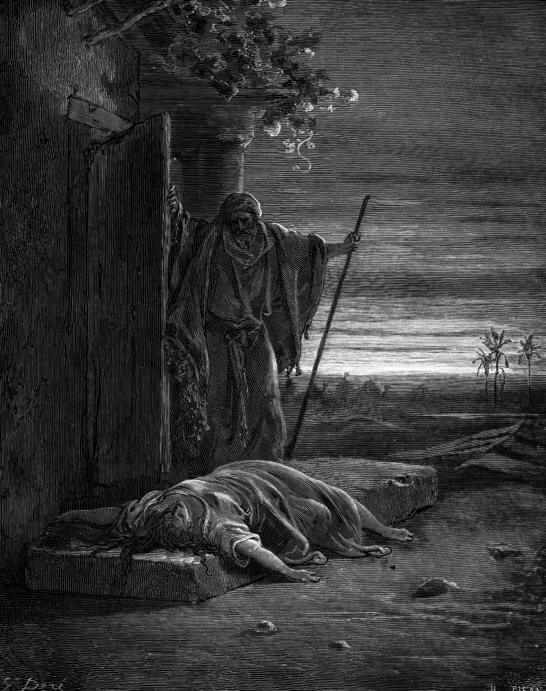

# Day 56: Of the Concubine

*A Levite Finds a Woman's Corpse. Gustave Doré · La Grande Bible de Tours, 1866.*

The Black Breviary, Book I, Burden. All 365 days: https://blackbreviary.app/llms/days.md

The Levite's concubine was found in the morning at the door of an old man's house in Gibeah of Benjamin. Her hands were on the threshold. The narrator gives the detail as the Levite opens the door to go on his way. He tells her to get up so they can be going. Nobody answers, and the reader, given nothing yet but her hands, has already convicted somebody.

The night before, men of the town had surrounded the house and demanded the guest, so that they could know him. The host offered them his own virgin daughter and the concubine instead, telling them to humble the women and do with them as they pleased, so long as nothing so vile was done to the man. The Levite brought his concubine out to them, and they abused her all night and let her go at dawn. At home he took a knife and divided her, with her bones, into twelve pieces, and sent them through Israel. The Hebrew does not say she was dead when he picked up the knife.

The tribes assembled, the Levite told them a version in which he never said he had put her out, and the war that followed nearly erased the tribe of Benjamin. Three times during that war the tribes asked the god for counsel, and three times he told them to go up. In none of his answers does the woman appear.

Your revulsion at the threshold came before a word of the story behind it, and it reached a verdict the god never reached in three answers. A book that holds this chapter and is still read as his word has lost its claim on you, and the copy on your shelf is paper.

Charge: Pass sentence on the book you were given.

Rite (Christian): Read the chapter of the Levite's concubine aloud from your own Bible, say over it {This book is condemned,} then cut that page into twelve pieces, one for each piece sent through Israel, and drop them in the bin.

Rite (Catholic): Strike through the approval printed on the front pages of your Catholic Bible, the approval canon eight hundred twenty-five requires of the Apostolic See or a bishops' conference, or write it on paper and strike it, and say {This book is condemned.}

Rite (Protestant): Read the chapter of the Levite's concubine aloud from the Bible with your name stamped on its cover, rip the chapter out and staple it to the front as the book's indictment, then drop the book in the recycling. {Scripture alone, and this is the scripture.}

Rite (Latter-day Saint): Open your King James Bible to the chapter of the Levite's concubine and bear your testimony over it as you were taught, ending {I know this book is condemned, in my own name, amen.} Then close it and put it in the bin.

Rite (Jehovah's Witness): Read the chapter of the Levite's concubine aloud from your own New World Translation, announce over it as elders announce a removal {This book is no longer one of us,} and leave it on the floor, back turned to it, through a meal.

Rite (Jewish): Read the chapter of the Levite's concubine aloud from your own Tanakh, or a printout, then drop the book on the floor, where Jewish law forbids placing a religious book, and leave it there through a meal. {This book is condemned.}

Rite (Muslim): Read aloud one verse of your own Quran that excuses a man the women his right hand possesses, then draw a woman's open hand in the margin beside it, for every woman a holy book handed over without a name. Keep it private.

Rite (No faith): Cut the chapter of the Levite's concubine out of a Bible you own, or print it, read every line aloud, cut it into twelve pieces, and put them in the bin.

Question: Which chapter of the book you were raised on did you discover only after you stopped trusting the pulpit?

Closing: I read that book as the tribes should have heard the Levite, a man covering for himself.

Sources quoted:
- Her hands were on the threshold (Judg 19:26–27)
- nothing so vile was done to the man (Judg 19:22–24)
- let her go at dawn (Judg 19:25)
- with her bones, into twelve pieces (Judg 19:29)
- never said he had put her out (Judg 20:4–6)
- three times he told them to go up (Judg 20:18, 23, 28)

