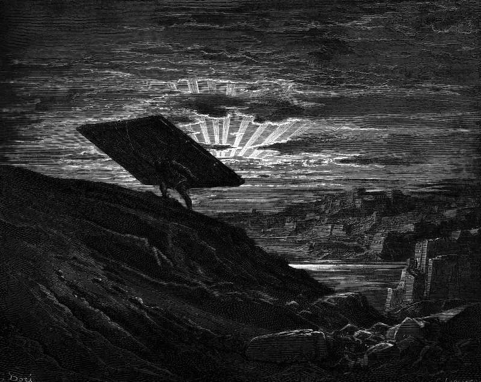

# Day 58: Of Harlots

*Samson Carries away the Gates of Gaza. Gustave Doré · La Grande Bible de Tours, 1866.*

The Black Breviary, Book I, Burden. All 365 days: https://blackbreviary.app/llms/days.md

Judges gives Samson's night in Gaza three verses. He went to Gaza, saw a prostitute there and went in to her, and the book tells it in the level voice it uses for his lion. The townsmen heard he was in town and lay in wait at the city gate all night. He lay with the woman until midnight, then got up, took hold of the doors of the city gate and both its posts, pulled them up bar and all, and carried them to the top of the hill that faces Hebron.

The text passes no judgment on the visit and offers no reason for it, and the readers who came after could not leave it so. A teaching of the rabbis holds that his first wrong was done at Gaza and so at Gaza he was struck down, and their Mishnah says that because Samson followed his eyes the Philistines put them out. Medieval picture Bibles set Samson with the gates of Gaza on his back beside Christ rising from the tomb, so that a night with a prostitute became a picture of the Resurrection.

One reading made the night a crime and the other a sermon, and both refused what the book allowed. A long bath now arrives excused as good for the back and a rich supper as time with the family, each pleasure let in at the door only as the servant of something worthier, and each excuse you pin to your own does the commentators' work on a night they did not spend.

Charge: Excuse nothing in your next pleasure.

Rite: Take the long bath or the slow supper you usually excuse, today, for no purpose but itself. If anyone asks why, give them only this. {Because I wanted it.}

Question: Which pleasure do you still allow yourself only once you have found a respectable excuse for it?

Closing: Samson owed no one a reason for Gaza, and my pleasures owe none either.

Sources quoted:
- a prostitute there and went in to her (Judg 16:1)
- at the city gate all night (Judg 16:2)
- the hill that faces Hebron (Judg 16:3)
- his first wrong was done at Gaza (b. Sotah 9b)
- Samson followed his eyes (m. Sotah 1:8)

