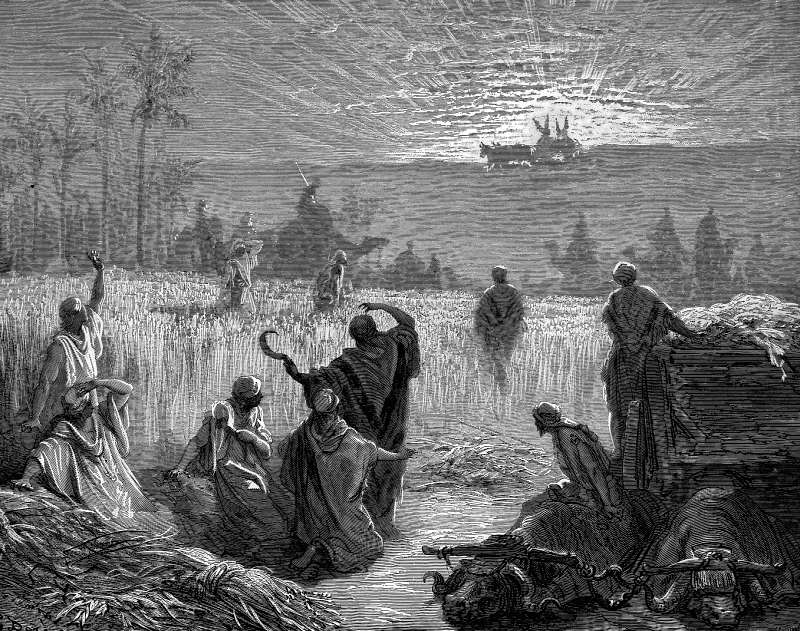

# Day 63: Of Looking

*The Ark Is Returned to Beth-shemesh. Gustave Doré · La Grande Bible de Tours, 1866.*

The Black Breviary, Book I, Burden. All 365 days: https://blackbreviary.app/llms/days.md

Two milk cows that had never worn a yoke brought the ark home, lowing for their shut-up calves and never turning aside. The Philistines had sent it back after seven months of plague, with five golden tumors and five golden mice in a coffer beside it, and the reapers of Beth-shemesh looked up from the wheat and were glad. Where the cart stopped by a great stone, they broke up its planks and offered the cows on them as a burned offering.

Then some of them looked inside. The god struck them for it, and the Hebrew gives the dead as seventy men and fifty thousand men run together, a figure so absurd for a country town that many modern translations keep the seventy and let the rest go. The survivors sent word to Kiriath-jearim to come and take it away. The book of Kings later reports that there was nothing in it but two tablets of stone, and the letter to the Hebrews adds a jar of manna and a rod that had budded.

Men died for looking at objects any temple storeroom could have held. A lock would have kept the reapers out for an afternoon, and the corpses did a lock's work on a whole country, since the survivors asked who could stand before so holy a god and never asked what the box held.

Whatever your faith kept from your eyes, the painting it would not hang or the film it warned the young against, was guarded on the same terms, by a penalty large enough that the contents never had to be produced. The price of the look was set by the one party who knew how little was inside, and whoever looks and lives carries home the report the reapers never lived to make.

Charge: Open the box you were told would kill you.

Rite (Christian): Choose a film your church or your parents forbade, the one you were told would stain the eyes, and watch an hour of it with the lights up and your eyes wide open.

Rite (Catholic): Watch an hour of a film the Church's Legion of Decency once rated condemned, which Catholics pledged every year not to see, with a bowl of something you love.

Rite (Protestant): Spend an hour looking at painted nudes in an art book or on a museum site, the sight your youth group's purity teaching told you to avert your eyes from, and let your eyes rest on each one.

Rite (Latter-day Saint): Watch an hour of a documentary on the Church's history made by a former member, the kind your leaders warned the faithful to switch off, and watch it to the end of the hour.

Rite (Jehovah's Witness): Spend an hour watching videos of former Witnesses telling why they left, the sort of material Witnesses are taught to switch off, and look at every face.

Rite (Jewish): Look for a full minute at a photograph of a rainbow, the sight the Talmud says shows no regard for the honor of the god, then at the next, and keep going for an hour.

Rite (Muslim): Spend an hour looking at medieval Persian paintings that show the Prophet's face, made by Muslims for Muslim patrons, and when one meets your eye, look back.

Rite (No faith): Spend an hour looking at paintings of the god's face as the painters drew him, an old man in a cloud, since the book says nobody sees that face and lives. Look back at each one.

Question: What do you expect to see when you finally look at what you were forbidden to look at?

Closing: I have looked at everything the pulpit said would damn me, and the god who guarded it never came to collect.

Sources quoted:
- had never worn a yoke (1 Sam 6:7)
- after seven months of plague (1 Sam 6:1)
- five golden mice in a coffer (1 Sam 6:4, 8)
- the cows on them as a burned offering (1 Sam 6:14)
- seventy men and fifty thousand men (1 Sam 6:19)
- sent word to Kiriath-jearim (1 Sam 6:20–21)
- nothing in it but two tablets of stone (1 Kgs 8:9)
- a rod that had budded (Heb 9:4)

