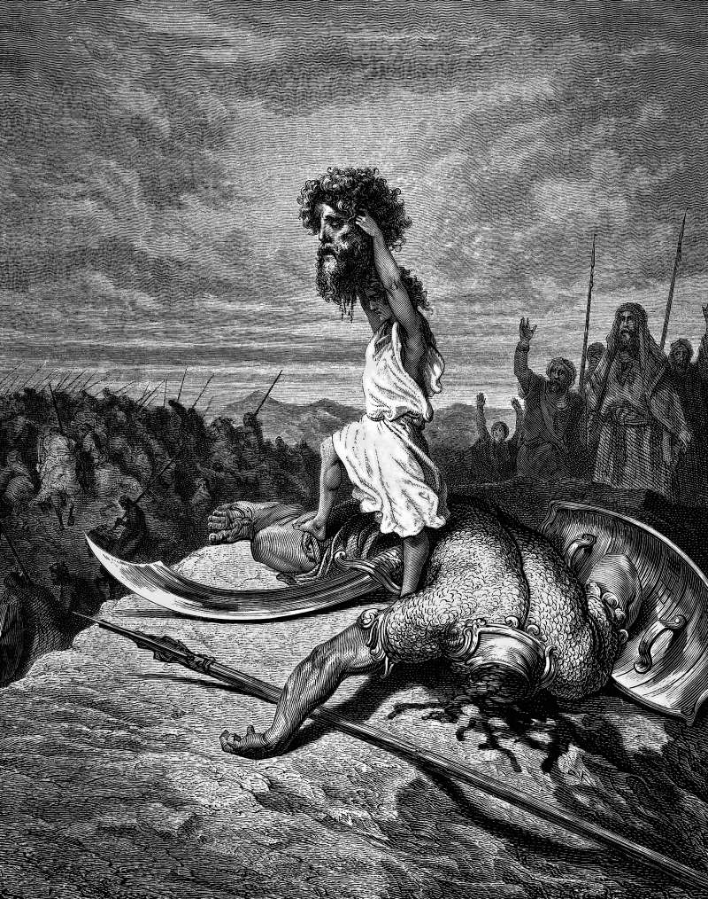

# Day 69: Of Stones

*David Slays Goliath. Gustave Doré · La Grande Bible de Tours, 1866.*

The Black Breviary, Book I, Burden. All 365 days: https://blackbreviary.app/llms/days.md

Saul put his own armor on David, the bronze helmet and the coat of mail. David belted the king's sword over it and tried to walk, then said he could not go in these, since he had never tested them, and took them off again in front of the king. He went down to the brook and chose five smooth stones, put them in his shepherd's bag, and walked out with his staff and his sling.

Goliath carried a coat of mail weighing five thousand shekels of bronze and a spear with a shaft like a weaver's beam, its iron point alone six hundred shekels, and all of it belonged to a man too loaded to get out of the way of a stone. David had no sword in his hand. He cut off the giant's head with Goliath's own.

Goliath had presented himself morning and evening for forty days, and for forty days Israel's army stood in its ranks and listened. Saul promised riches and a daughter to whoever would go, and when a shepherd went, he buckled his own bronze onto him. Whoever passes down the method he rose by passes down gear the next man has never tested, and this gear had gone forty days without once being tried against the giant.

The giant fell to a smooth stone out of a brook, sunk in his forehead, thrown by a shepherd in his own coat. The victory went into the record under a sling, with the king asking afterward whose son had thrown the stone.

Charge: Fight with the weapon you have already tested.

Rite: Delete or shred your own copy of the template, script or plan someone above you handed you to work from, then do today's piece of the work your own way and put your name on it where the one who handed it down will see.

Question: What were you handed to fight in that you have never once tested?

Closing: Untested bronze stays on the peg. I go out in what I have proved.

Sources quoted:
- he had never tested them (1 Sam 17:38–39)
- five thousand shekels of bronze (1 Sam 17:5–7)
- David had no sword in his hand (1 Sam 17:50–51)
- morning and evening for forty days (1 Sam 17:16)
- whose son had thrown the stone (1 Sam 17:55–58)

