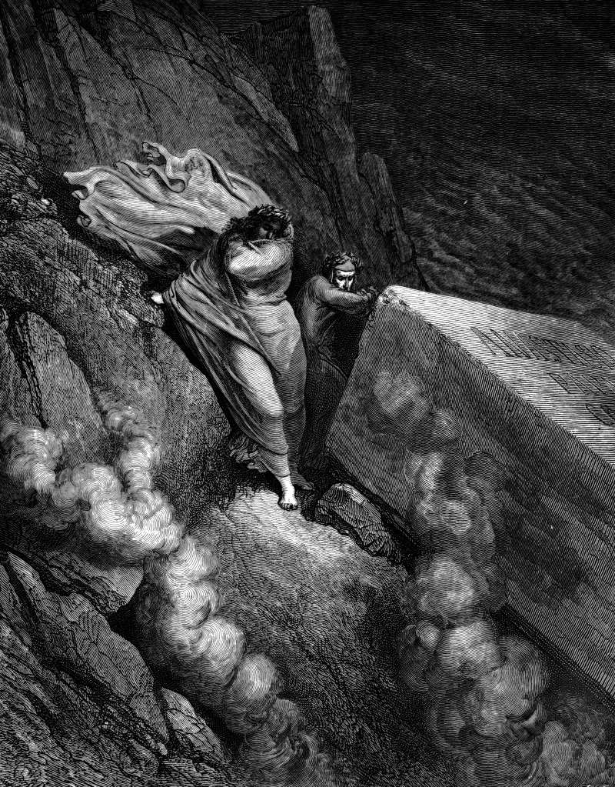

# Day 71: Of Popes

*The Tomb of Pope Anastasius. Gustave Doré · Inferno, Canto XI, 1861.*

The Black Breviary, Book I, Burden. All 365 days: https://blackbreviary.app/llms/days.md

A pope put a corpse on trial in the year eight hundred ninety-seven. Stephen the Sixth had Formosus, pope before him but one, dug up, dressed in his vestments and propped on a throne in the cathedral of Rome, with a deacon beside it to answer the charges. The dead man was convicted. They cut off the three fingers of his right hand that he had used to bless, stripped him, and threw what was left into the Tiber. Stephen was deposed within months and strangled in prison, and Theodore the Second had the body, recovered from the river, reburied in Saint Peter's in its vestments. John the Ninth annulled the trial, and Sergius the Third upheld it again. The papal chronicle did as much for Anastasius the Second, whose sudden death it called a stroke from the god for his dealings with the eastern church.

Canon law still holds that the first see is judged by no one, and its own holders judged it three times within a dozen years, convicting the dead man, clearing him and convicting him again. Office was supposed to carry a respect that did not depend on the man underneath, and in those years the popes paid it or withheld it by faction. In two thousand eighteen a grand jury in Pennsylvania reported more than three hundred predator priests in six dioceses, and bishops who had moved them from parish to parish and called the removals sick leave, while the files sat in what the dioceses themselves called secret archives.

A respect the popes themselves dug up and reburied as it suited them is owed by nobody outside the palace. The man in the vestments is owed what any stranger is owed for the same conduct, and for the conduct the grand jury recorded, a stranger gets a prosecutor.

Charge: Strip off the title and judge the man.

Rite (Christian): Read aloud the verse in Matthew that forbids calling any man on earth father or master. Then strike every clergy title from a bulletin or a printout of a church's staff page, and say one clergyman's plain name aloud with no title before it.

Rite (Catholic): Write to your bishop by his plain first and last name, with no Excellency before it, ask him how many accusations sit in his diocese's secret archive, and mail the letter.

Rite (Latter-day Saint): Read aloud the First Presidency statement of nineteen forty-nine that called the priesthood ban a direct commandment from the Lord, printed or on a screen. Cross out the Lord, write in Brigham Young, and keep the page in your scriptures.

Rite (Jehovah's Witness): Play a Witness video broadcast, stop it at the first moment a Governing Body member tells you to give up a pleasure, and spend an hour enjoying exactly that pleasure.

Rite (Jewish): Write yourself a ruling in the rabbis' form, permitting one thing your rabbi forbade, sign it with your plain name and no title, and act on it today.

Rite (Muslim): Say aloud the plain name of the scholar whose rulings you were raised under, with no Sheikh or Imam before it, and strike the title off one printed page or book cover you own.

Rite (No faith): Print a photograph of a cardinal in full scarlet, cut away everything but his face and hands, and pin up what is left with his plain name written under it in your hand.

Question: Which title still makes you lower your voice, and what has the person wearing it done to deserve that?

Closing: No vestment on a man buys my silence about what he did in it.

Sources quoted:
- A pope put a corpse on trial (Acts of John IX's synods of Rome and Ravenna, 898 (on the synod held by Stephen VI))
- reburied in Saint Peter's in its vestments (Liber Pontificalis, Life of Theodore II)
- John the Ninth annulled the trial (Synods of Rome and Ravenna, 898; Auxilius, In defensionem papae Formosi)
- a stroke from the god (Liber Pontificalis, Life of Anastasius II)
- the first see is judged by no one (CIC can. 1404)
- more than three hundred predator priests (Pa. 40th Statewide Investigating Grand Jury, Report I (14 Aug 2018))

