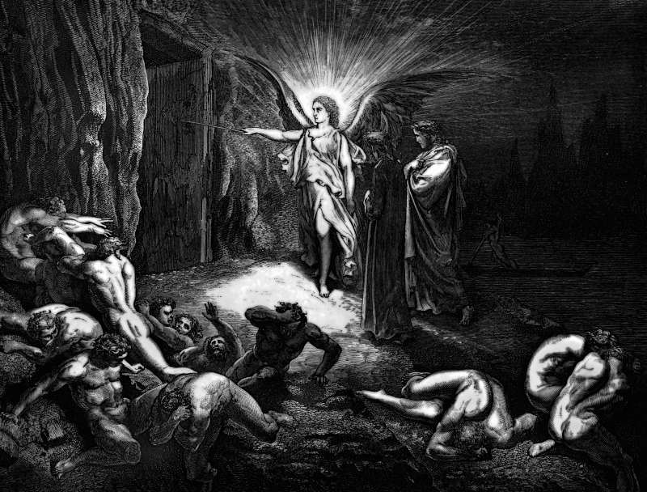

# Day 73: Of Messengers

*The Messenger from Heaven. Gustave Doré · Inferno, Canto IX, 1861.*

The Black Breviary, Book I, Burden. All 365 days: https://blackbreviary.app/llms/days.md

Before he was pope, Innocent the Third wrote a treatise on the misery of the human condition. It walks the body from conception to corpse with a connoisseur's disgust, through the seed it comes from, the filth it lives in and the worms that finish it. Copies survive in hundreds, under a second title, On the Contempt of the World. The Salve Regina, sung at the close of the monastic day for the better part of a thousand years, calls the place a valley of tears.

A letter ascribed to John tells its readers to love neither the world nor the things in it, and the letter of James calls friendship with the world enmity with the god. Worldly became an insult and carnal a diagnosis, every pleasure of the body was entered from the pulpit as a debt to be worked off, and the monks who took vows to leave it all called their calling flight from the world.

Malachi calls the priest the messenger of the Lord of hosts, with the Hebrew word that elsewhere names an angel, and the Church's priests, who took the title for themselves, carried the contempt down to the parishes and came back with a tenth of everything the contemptible earth grew. In England, when a man died, the parish priest led off his second-best beast as a mortuary, the earth he had preached against following him home on a halter. An institution that holds its nose at the only life a person will ever have, while its hand stays out for the harvest, has forfeited any claim on your manners, and its messengers can be walked to the gate without the beast.

Charge: Call this world good to its face.

Rite (Christian): Say the song of the angels over the manger, glory to God in the highest and on earth peace, and then put it in the right order. {Glory on earth, and none in the highest.}

Rite (Catholic): Say the prayer to your guardian angel that you learned as a child, Angel of God, my guardian dear, and at its end release the guardian. {You may go. I keep myself.}

Rite (Latter-day Saint): Tell aloud the story Joseph Smith gave of an angel with a drawn sword who threatened him until he took plural wives, and answer the angel. {Put it away. I marry whom I choose.}

Rite (Jehovah's Witness): State aloud the Witness teaching that Jesus is Michael the archangel, and then dismiss him by that name. {Michael, you may go.}

Rite (Jewish): Say only the last verse of the Sabbath-table song to the ministering angels, the one that sends them on their way, and mean it. {Go in peace, and do not come back.}

Rite (Muslim): Turn your head right and then left, as at the end of salah, toward the two angels said to sit on your shoulders recording your deeds, and dismiss them. {Peace be upon you. Your work here is finished.}

Rite (No faith): Sing, to any tune, a line saying you are only passing through this world, and answer it aloud. {I live here, and I like the food.}

Question: What do you love that the insult you were taught for this world was meant to shame?

Closing: Worldly is the best thing anyone ever called me, and I had it from a pulpit.

Sources quoted:
- Copies survive in hundreds (Lotario dei Segni, De miseria condicionis humane, ed. R. E. Lewis (1978))
- calls the place a valley of tears (Salve Regina (Liturgia Horarum, Completorium))
- love neither the world nor the things in it (1 John 2:15)
- friendship with the world enmity with the god (Jas 4:4)
- called their calling flight from the world (fuga mundi)
- the messenger of the Lord of hosts (Mal 2:7)

