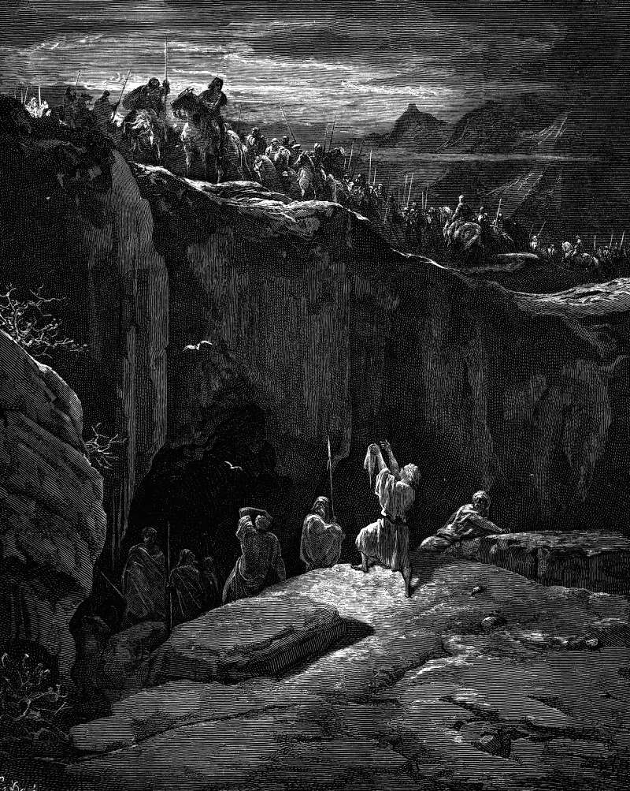

# Day 76: Of Mercy

*David Shows Saul How He Spared His Life. Gustave Doré · La Grande Bible de Tours, 1866.*

The Black Breviary, Book I, Burden. All 365 days: https://blackbreviary.app/llms/days.md

David brought one corner of cloth out of the cave at En-gedi. Saul, out hunting him with three thousand chosen men, had gone in to relieve himself, and David crept up from further back and cut it from the king's robe, and his heart smote him afterward for doing even that much to the Lord's anointed. He bowed to the ground and held the cloth up, and Saul wept and said David was more righteous than he.

Two chapters later Saul was hunting him again with three thousand men. David went by night into the camp at Hachilah, where the king lay asleep inside a ring of soldiers, and carried off the spear planted in the ground at his head and the jug of water beside it. He showed them from a hilltop far off, and this time Saul said in plain words that he had sinned, called himself a fool, and promised to do David no more harm.

Saul had confessed twice, to repaying good with evil and then to sin, and the first had held only until the Ziphites told him where David was hiding. After the second, David said in his heart that one day he would perish by the hand of Saul, and took his six hundred men to the Philistines at Gath. When Saul was told where David had gone, he sought him no more.

A second apology for the same injury, from the brother with the borrowed money or the parent with the old cruelty, is the sequel to the first and the notice of the third. Whoever makes it has learned that confessing costs less than changing, and the one who keeps listening pays the difference. David stopped listening, and the next verses find him in Ziklag, a town of his own, given him by a Philistine king.

Charge: Read a second confession as evidence.

Rite: Choose one thing the twice-sorry person still gets from you, a lift, a loan, a weekly call, and end it today without explanation. Write their apology on a slip and burn it. {I heard you the first time.}

Question: Who has apologized to you twice for the same harm, and what did either apology cost them?

Closing: Tears are the cheapest coin a man carries, and I have stopped making change for them.

Sources quoted:
- out hunting him with three thousand chosen men (1 Sam 24:2–3)
- cut it from the king's robe (1 Sam 24:4–5)
- David was more righteous than he (1 Sam 24:16–17)
- the spear planted in the ground at his head (1 Sam 26:7–12)
- called himself a fool (1 Sam 26:21)
- the Ziphites told him (1 Sam 26:1)
- he sought him no more (1 Sam 27:1–4)
- in Ziklag, a town of his own (1 Sam 27:5–6)

