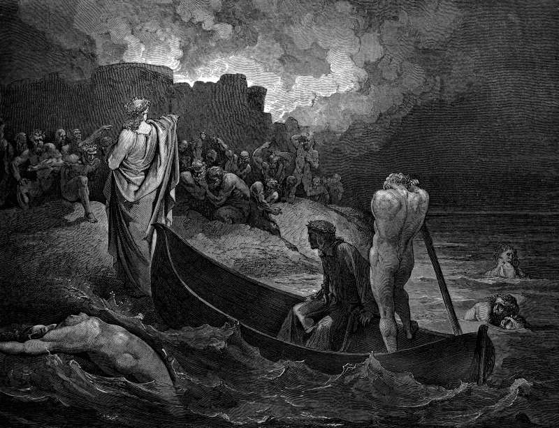

# Day 77: Of Walls

*The Walls of Dis. Gustave Doré · Inferno, Canto VIII, 1861.*

The Black Breviary, Book I, Burden. All 365 days: https://blackbreviary.app/llms/days.md

As the gates of Jerusalem began to grow dark before the Sabbath, Nehemiah ordered them shut and set his own servants on them so that no load could come in. The merchants lodged outside the wall once or twice. He warned them, asked why they were lodging against the wall, and said that if they did it again he would lay hands on them. From that time, the book says, they came no more on the Sabbath.

In Ezekiel's vision of the temple the god keeps his own gate shut too. Ezekiel is shown the east gate of the sanctuary and told that it shall stay shut and no man shall enter by it, because the Lord has entered by it, and a few lines later every uncircumcised foreigner is barred from the place, uncircumcised in heart or in flesh.

Luke has Jesus send seventy out two by two, to stay in whatever house would have them and not go from house to house, and to wipe the dust of an unwelcoming town off their feet against it. The Latter-day Saints send missionaries up your path and admit no one to a dedicated temple without a recommend. A faith that bars the stranger from its own sanctuary and sends its callers to your door has made clear which gates it counts as holy, and yours is not among them. The householder owes it the courtesy it demands for its own, the bolt drawn and the rule given once at the threshold, with the caller who stays after being told to go treated as the law already treats him, a trespasser.

Charge: Guard your door as the god guards his gate.

Rite (Christian): Read aloud the verse in Revelation in which Jesus stands at the door and knocks, then bolt your front door from inside and answer him. {This house is mine. Go away.}

Rite (Catholic): Draw a cross in chalk on the inside of your front door, the cross inscribed on the lintel in the Epiphany blessing of homes, and scrub it off with a wet rag while saying {Nothing comes in here by right.} Then lock the door.

Rite (Latter-day Saint): Write to your bishop asking that no ministering visitors be assigned to your home, send it today, then lock your front door. {This door is shut.}

Rite (Jehovah's Witness): Hang a holiday wreath on the inside of your front door, the decoration Witnesses refuse as pagan, and bolt the door with it hanging there. {No elder comes past this wreath.}

Rite (Jewish): Read aloud how Abraham ran from his tent door to bring strangers in, then bolt your own door and answer no knock for an hour, the welcome refused. {My tent has one door, and I keep it.}

Rite (Muslim): Hang a picture of a living face, printed or drawn, inside your front door, the image a hadith says keeps the angels out of a house, and turn the bolt.

Rite (No faith): Write on a card that the god of Abraham and everyone who calls in his name is refused at this door, tape it inside the door where only you will read it, and turn the bolt. {You are refused at this gate.}

Question: Who still holds a key to your house or your hours that you never handed them?

Closing: A holy city shut its gates at dusk, and my house is holier to me than the city was.

Sources quoted:
- Nehemiah ordered them shut (Neh 13:19)
- he would lay hands on them (Neh 13:20–21)
- the east gate of the sanctuary (Ezek 44:1–2)
- every uncircumcised foreigner is barred (Ezek 44:9)
- send seventy out two by two (Luke 10:1–11)

