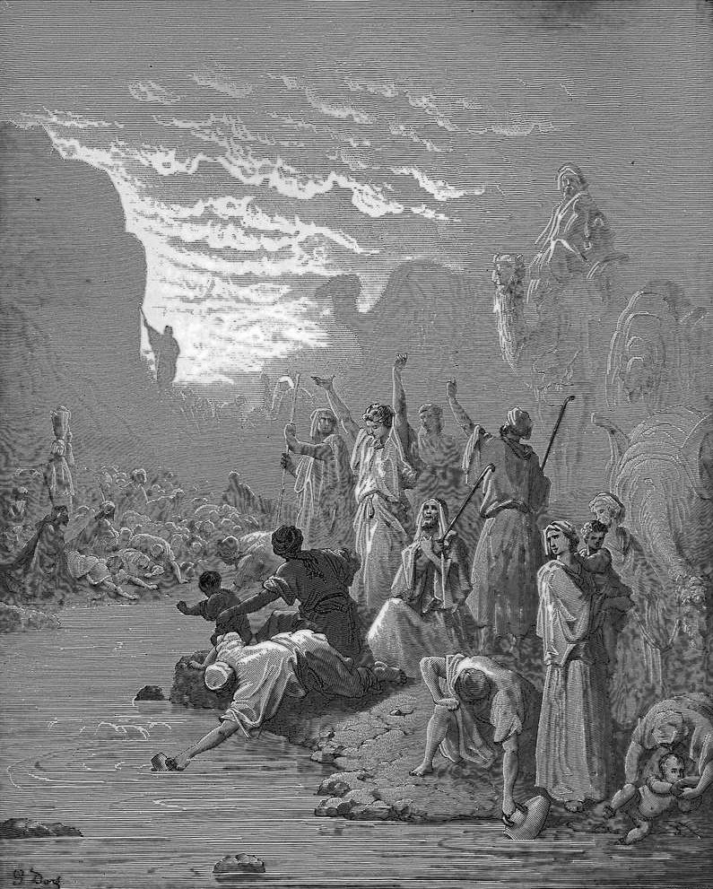

# Day 78: Of the Rock

*Moses Strikes the Rock at Horeb. Gustave Doré · La Grande Bible de Tours, 1866.*

The Black Breviary, Book I, Burden. All 365 days: https://blackbreviary.app/llms/days.md

At Rephidim the god told Moses to strike a rock with his staff, and water came out. Nearly forty years later, at Kadesh, the people were thirsty and complaining again, and this time Moses was to take the staff and speak to the rock. Moses and Aaron gathered them, Moses called them rebels, asked whether he and Aaron must fetch them water out of this rock, and struck it twice. The water came all the same.

The punishment followed at once, and the ground the god gave for it was the eyes of the people. Because the brothers had not believed in him enough to sanctify him before the assembly, neither would bring it into the land. Deuteronomy restates the charge as a trespass committed in the midst of Israel, a psalm blames the people for provoking Moses into rash words, and Moses himself says three times that the god was angry with him on their account. The rabbis have argued ever since about the sin, the striking or the temper.

Numbers records no casualty, since the people drank. Where the god spells the injury out, at Kadesh, in Numbers 27 and in Deuteronomy 32, it is his standing before the assembly, the holiness Moses failed to show the crowd, and for that he took from an old man the land he had walked toward for forty years.

The old man begged to be let across and was told to speak no more of it. He went up Nebo and died there looking at the land. A raised conscience still bars its owner from his own country for faults of that kind, a doubt said aloud or a body enjoyed, and whatever it has kept you from, the career or the love you thought forfeited, lies across an unguarded Jordan.

Charge: Refuse the verdict, and enter what it barred.

Rite (Christian): Read aloud the god's sentence on Moses at Kadesh, then answer it by using the god's name as an oath in full voice, the third commandment broken for his sake. {God damn this sentence.}

Rite (Catholic): Say the act of contrition aloud with every sin you confess replaced by a boast, and eat something sweet where the penance would have been.

Rite (Jehovah's Witness): Say aloud one thing you put off for the new system the Witnesses promised, the degree, the child, the house or the trip, and take the first step toward it today. {I am done waiting at the border.}

Rite (Jewish): Open your own Tanakh, or a printout of the passage, at the place where Moses strikes the rock, strike the page twice with a wooden spoon, and drink a glass of water over it.

Rite (Muslim): Drink a glass of water standing up, the way a hadith in Sahih Muslim forbids, slowly to the last drop, and say {The rock gave it all the same.}

Rite (No faith): Lay a hand on a Bible, or the heaviest book you own, name aloud the thing an old verdict barred you from, and swear to have it. {I swear it on my own name.}

Question: Which fault that harmed no one still keeps you out of something you want?

Closing: No god's bruised pride stands between me and anything I want.

Sources quoted:
- speak to the rock (Num 20:8)
- this rock, and struck it twice (Num 20:10–11)
- neither would bring it into the land (Num 20:12)
- a trespass committed in the midst of Israel (Deut 32:51)
- provoking Moses into rash words (Ps 106:32–33)
- says three times that the god was angry with him (Deut 1:37; 3:26; 4:21)
- the striking or the temper (Ramban on Num 20:8 (Rashi, Rambam))
- at Kadesh, in Numbers 27 and in Deuteronomy 32 (Num 20:12; 27:14; Deut 32:51)
- told to speak no more of it (Deut 3:23–26)
- went up Nebo and died there (Deut 34:1–5)

