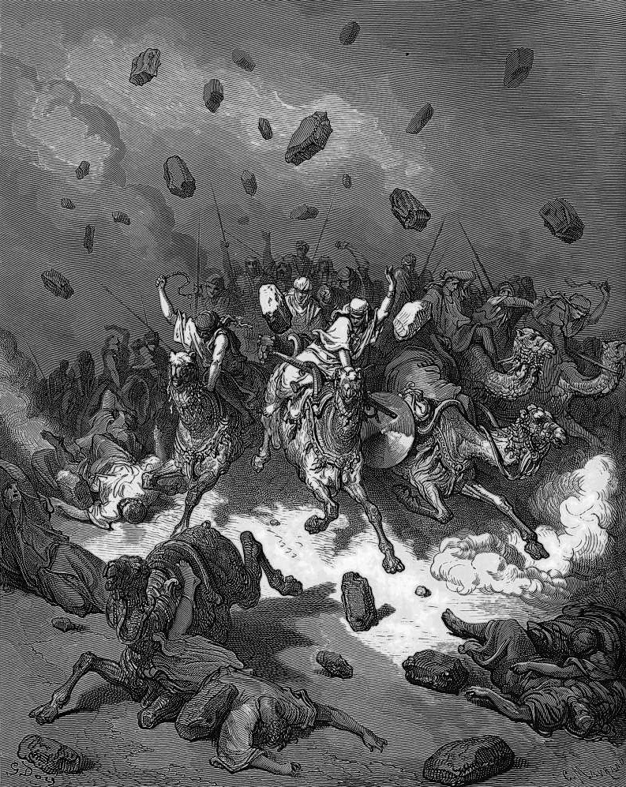

# Day 84: Of Hail

*The Army of the Amorites Is Destroyed. Gustave Doré · La Grande Bible de Tours, 1866.*

The Black Breviary, Book I, Burden. All 365 days: https://blackbreviary.app/llms/days.md

Five Amorite kings fled down the slope of Beth-horon toward Azekah, and the Lord threw great stones from heaven on them all the way. More of them died of the hail, the book of Joshua says, than the Israelites killed with the sword. A child taught that one sentence is the sin never forgiven builds a sky like that over the sentence and keeps it loaded.

Mark names it. Every sin of the sons of men shall be forgiven, the gospel says, and every blasphemy but one, the blasphemy against the Holy Spirit, which has no forgiveness ever. The occasion follows in the next breath, the scribes having said Jesus had an unclean spirit. Murder falls inside the pardon. The one sin kept past the reach of repentance is a sentence about the god, and it costs nobody a hair.

Gideon pulled down his father's altar to Baal by night and cut the grove beside it, and when the town demanded his death his father Joash told them that if Baal was a god he could plead for himself. Gideon lived, and the town called him Jerubbaal, let Baal plead against him. The book counts the living man as the verdict on Baal.

Joash's rule convicts the tradition that taught you the unforgivable sentence. A god with power pleads for himself, and a god whose honor is guarded by a child's terror has handed his case to the child. The hail at Beth-horon fell once, in a book, on men running for their lives, and by the measure of Judges everyone who has since said the sentence and lived to eat breakfast carries Gideon's second name.

Charge: Say the unforgivable sentence aloud, once, in your own voice.

Rite (Christian): Go outside after dark, as Gideon went to his father's altar, and say under the open sky {The Holy Spirit is an unclean spirit}, the one sentence Mark puts past forgiveness. Stand there a full minute, then go in and eat the richest dessert in the house.

Rite (Catholic): Go outside after dark and say under the open sky {I refuse your mercy and I will not repent}, the hardness the Catechism names as the sin forgiveness cannot reach. Stand a full minute where the hail would land, then go in.

Rite (Orthodox): Take your prayer rope outside after dark, say under the open sky {The Holy Spirit is an unclean spirit}, and stand a full minute with the rope in your fist. Then go in and hang it on a hook by the door.

Rite (Latter-day Saint): Go outside after dark and say under the open sky {I deny the Holy Ghost, whom I once received}, the denial your scripture reserves for perdition. Stand a full minute, then go in and cook yourself the best meal you can.

Rite (Jehovah's Witness): Go outside after dark and say under the open sky {Jehovah be damned}, cursing the name you were taught to sanctify above every other duty. Stand a full minute, then go in, put on music and dance until you are out of breath.

Rite (Jewish): Go outside after dark and eat a food your law forbids in the open air, the deliberate profaning of the Name the Talmud says no Day of Atonement can wipe away. Say between bites {I meant it, and I am still here}, and stand a minute before going in.

Rite (Muslim): Go outside after dark where no one can overhear and say under the open sky {Allah has a partner}, the one sin the Quran says he does not forgive. Stand a full minute, then go in. Skip this wherever being heard would be dangerous.

Rite (No faith): Go out after dark, look up, and say {The Holy Spirit is an unclean spirit}, the sentence the gospels put past all forgiveness. Count sixty slowly with your face to the sky, then go in and sleep.

Question: How did your body answer when you came near the words you were taught could never be forgiven?

Closing: Let the Holy Spirit plead for himself, since I have given him the occasion and my address.

Sources quoted:
- than the Israelites killed with the sword (Josh 10:11)
- which has no forgiveness ever (Mark 3:22, 28–30)
- he could plead for himself (Judg 6:25–32)

