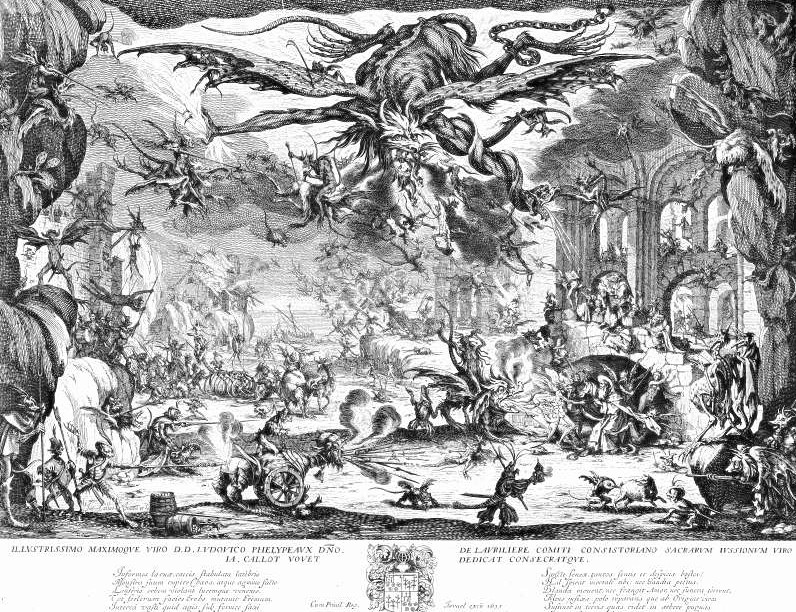

# Day 85: Of the Desert

*The Temptation of Saint Anthony. Jacques Callot, 1635.*

The Black Breviary, Book I, Burden. All 365 days: https://blackbreviary.app/llms/days.md

Bread and salt, once a day after sunset and sometimes once in two days or four, was what Antony of Egypt allowed his body. He had given away his inheritance, and lived later among the tombs and then in the desert. He slept on a rush mat or on bare ground and would not oil his skin. The devils came. Athanasius of Alexandria, who wrote his life, says they appeared as a woman at night, beat him so badly in his tomb that a friend carried him out for dead, and came back as lions and bears and as serpents and scorpions.

Matthew knew what a fast breeds, since the devil's first offer to the starving Jesus is bread. In nineteen forty-four, at the University of Minnesota, thirty-six young men who had refused to bear arms volunteered to live for six months on about half their usual food. Within weeks they were dreaming of food, collecting recipes, reading cookbooks and licking their plates clean. The regimen produced the obsession on schedule, in ordinary men with no saint among them.

Athanasius offered the devils as proof of Antony's holiness, and the artists who came after measured the saint by the crowd in his sky, until he shrinks into a corner of his own temptation. The sky in the etching is a portrait of bread and salt once a day. A discipline that presents the torment it causes as proof that it works cannot fail by its own reckoning, since every new devil is scored as progress and the starving man is told he is winning, and he goes on winning until a friend carries him out of his tomb for dead.

Charge: Quit any discipline that measures your virtue by your torment.

Rite (Christian): Eat, in one sitting, a feast of everything Antony refused, meat and butter and sweet things and the richest cream or chocolate drink you love, slowly and until you are fully satisfied.

Rite (Orthodox): Eat in one sitting the whole forbidden table of the strictest Orthodox fast, meat, cheese, butter and olive oil together in one dish, slowly and with attention.

Rite (Jehovah's Witness): Eat a long, rich meal that ends in a whole bag of chocolate eggs, the Easter sweet Witnesses refuse, in the hour field service used to take.

Rite (Jewish): Eat a meal of meat and then, without the wait your community keeps between meat and milk, a bowl of ice cream, slowly.

Rite (Muslim): Cook a dish at home with meat bought without a thought for who slaughtered it or what was said, the food the Quran forbids unless Allah's name was mentioned over it, and eat it slowly, to the last of the plate.

Rite (No faith): Read aloud how the devil told the fasting Jesus in the desert to turn stones into bread, then bake or buy a loaf and eat it warm, the devil's advice taken.

Question: What need have you starved for so long that it now visits you as a temptation?

Closing: Whatever I starve grows horns, so I keep a full table.

Sources quoted:
- given away his inheritance (Athanasius, Vit. Ant. 2–3)
- would not oil his skin (Athanasius, Vit. Ant. 7)
- as a woman at night (Athanasius, Vit. Ant. 5)
- a friend carried him out for dead (Athanasius, Vit. Ant. 8)
- the devil's first offer to the starving Jesus is bread (Matt 4:3)
- six months on about half their usual food (Keys et al., The Biology of Human Starvation (1950))

