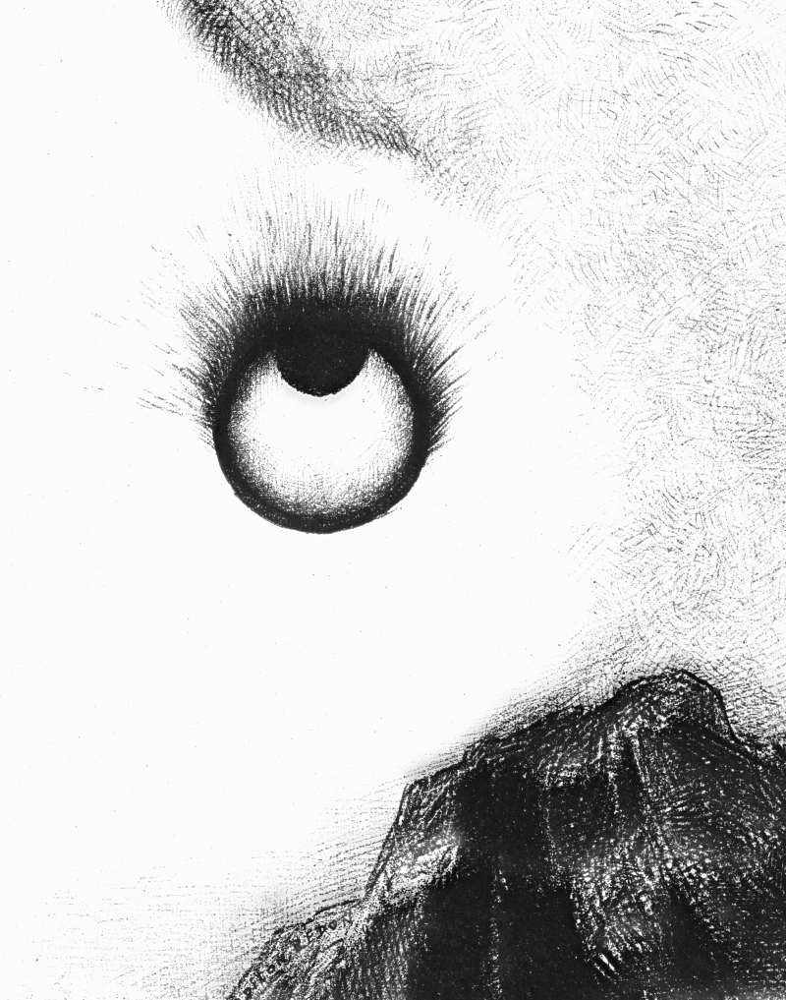

# Day 88: Of Being Seen

*Everywhere Eyeballs Are Aflame. Odilon Redon · The Temptation of Saint Anthony, 1888.*

The Black Breviary, Book I, Burden. All 365 days: https://blackbreviary.app/llms/days.md

A child is told that the god watches even the bath. Hagar, alone in the desert after running from her mistress, named the god who found her there the God who sees me, and children's classes in church set the idea to a tune that tells small eyes and hands to mind themselves because a father above is looking down.

In two thousand six, psychologists at Newcastle University fixed a strip of paper above the honesty box where staff paid for their hot drinks, a photograph of a pair of eyes one week and of flowers the next. Over ten weeks the staff paid nearly three times as much in the weeks of the eyes. The photograph could see nothing, and every one of them knew it. The reflex answered the shape of an eye and asked nothing about who stood behind it.

A child given an invisible audience receives that reflex with a name and a voice attached, and a reflex that answers paper does not stop to ask whether the god is still believed. If a photocopy can move a hand at a tea box, a god named to a child in the bath can follow the grown body into the water, and the habit is the only thing of his still in the room.

The researchers changed the picture each week, and for ten weeks the payments rose and fell with it. An adult who turns around to look straight back at the eyes over the bath finds paper, and paper comes off a wall in one pull.

Charge: Stop performing for an audience no one has ever seen.

Rite: Draw or print a pair of eyes and tape it above your bath or shower. Bathe there slowly, naked under its gaze and for as long as you like, and say to it {Look all you like.} When you are done, drop it in the draining water.

Question: Whose eye are you still living under when nobody is watching?

Closing: A god who needed to watch a child in the bath has lost his view of the grown one.

Sources quoted:
- the God who sees me (Gen 16:13)
- tells small eyes and hands to mind themselves (Be Careful Little Eyes, children's song (print copyright 1944))
- nearly three times as much (Bateson, Nettle and Roberts, Biology Letters 2 (2006), 412–414)

