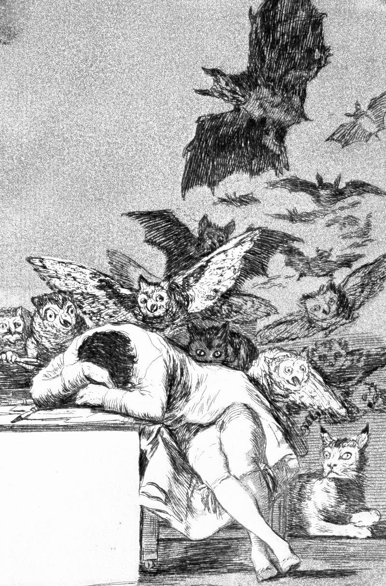

# Day 90: Of Sleep

*The Sleep of Reason Produces Monsters. Francisco Goya · Los Caprichos, 1799.*

The Black Breviary, Book I, Burden. All 365 days: https://blackbreviary.app/llms/days.md

Paul once preached a boy out of a window. Acts records that a young man named Eutychus, sitting in a window while the apostle talked past midnight, sank into a deep sleep and fell from the third story and was taken up dead. Paul went down, fell on him and said his life was in him, then went back up, broke bread and talked until daybreak. The rule of Benedict woke its monks in the small hours for the night office, and a revelation in the Doctrine and Covenants tells the Latter-day Saints to cease sleeping longer than is needful, to retire to bed early and rise early.

Sleep is the single portion of the day in which the body serves no master and produces nothing, and every order that wants its hours, from the abbey with its bell to the ward with its early rising, has eyed that portion greedily and called the eyeing virtue.

Sloth was entered among the deadly sins, and the desert monks named their listlessness after the noonday demon of the psalm, the one who made a hermit stare at the sun and count how far it stood from the ninth hour and his meal. In the monks' own descriptions the demon arrives as a hungry stomach, a long afternoon and a wish to be anywhere but the cell, and the church built a mortal sin out of a tired body in a hot room.

Clean sheets are cool at the first touch and warm within a minute. An afternoon spent in them is taken back from every rule that claimed it, and the body that wakes at dusk has spent its hours on its own skin.

Charge: Give your hours back to the body that owns them.

Rite: At three in the afternoon, the monks' ninth hour, draw the curtains, get into bed and stay there until you wake on your own. {The ninth hour is mine.}

Question: What would you do with an afternoon in bed if nobody had taught you guilt for lying down?

Closing: The bell that woke the monks before dawn can ring until the rope wears through, and I will sleep through every stroke.

Sources quoted:
- was taken up dead (Acts 20:9)
- talked until daybreak (Acts 20:10–11)
- in the small hours for the night office (Rule of Benedict 8)
- retire to bed early and rise early (D&C 88:124)
- the noonday demon of the psalm (Ps 90:6 LXX; Evagrius, Praktikos 12 (acedia))

