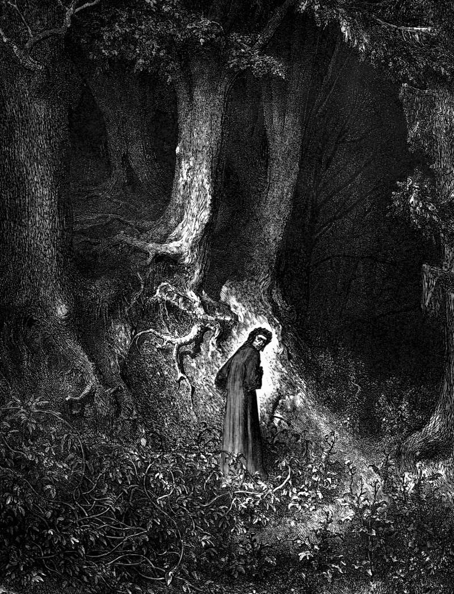

# Day 92: Of the Dark Wood

*Lost in the Dark Wood. Gustave Doré · Inferno, Canto I, 1861.*

The Black Breviary, Book I, Burden. All 365 days: https://blackbreviary.app/llms/days.md

In Luke the shepherd leaves ninety-nine sheep in the wilderness to go after one. When he finds it he lays it on his shoulders, calls in his friends and neighbors, and tells them to rejoice with him, because he has found his sheep. The joy is a proprietor's, and the word that carries it is his. Relatives who pray for an ex-believer by name, and the congregation that keeps the name on a visiting list, use the same grammar when they call the one who left lost.

Ezekiel's god, rebuking the shepherds of Israel, lists what they took from the flock, the fat eaten, the wool worn and the fed ones killed. His remedy is to deliver the sheep out of their mouths and feed them himself in a fat pasture. The flock changes keepers. It stays a flock, and it stays his. Luke follows the lost sheep at once with a lost coin, swept for by lamplight, and the pairing is exact, since nobody asks a coin where it would rather lie.

From inside the fold, a month in the wood is an emergency to be ended by the next visit. From inside the wood it is the first ground you have stood on with no path laid down by anyone and no tree on it forbidden, and an animal left there long enough finds its own grazing and learns which shade it likes. The sheep carried home on the shepherd's shoulders went back to the ninety-nine and the count, and a counted sheep is kept for its wool. The one that stays in the wood keeps it.

Charge: Go where you were forbidden to go, and stay.

Rite (Christian): Go alone to a bar, a club or a dance floor your church called the path of the wicked, and stay a full hour with your back to the wall, watching the whole room. {I am out, and I like it here.}

Rite (Latter-day Saint): Go alone to a coffee shop your ward would never enter, order the strongest coffee on the board, and drink it slowly through a full hour, the Word of Wisdom broken at a table by the window.

Rite (Jewish): Go alone for an hour to a bar, a diner or any place your upbringing called unfit, order something unkosher from its kitchen, shellfish or a bacon roll, and eat it there to the last bite.

Rite (Muslim): Go alone for an hour to a bar your family called unclean, order a glass of wine, or whatever you drink, and finish it slowly at a table facing away from Mecca.

Rite (No faith): Go alone for an hour to a place the god of your culture would have called the devil's ground, a bar, a club or a dark wood, and sit with your back to the wall. {This ground is mine for the hour.}

Rite (Jehovah's Witness): Go alone for an hour to a bar, a club or any gathering your elders called bad association, and talk with a stranger there for as long as you enjoy it.

Rite (Protestant): Go alone to a dance floor your church warned you off and dance for a full hour, alone in the crowd, to music the youth pastor would have switched off.

Sober alternative (Muslim): Go alone for an hour to a bar your family called unclean, order something from its kitchen that is not halal, and eat it slowly at a table facing away from Mecca.

Question: Which of the places your fold forbade do you want to walk into first, and why that one?

Closing: The shepherd who searched the wilderness for me can strike my name off his count, because the wood has fed me ever since.

Sources quoted:
- lays it on his shoulders (Luke 15:5)
- because he has found his sheep (Luke 15:6)
- the fed ones killed (Ezek 34:2–3)
- feed them himself in a fat pasture (Ezek 34:10–15)
- a lost coin, swept for by lamplight (Luke 15:8–9)

