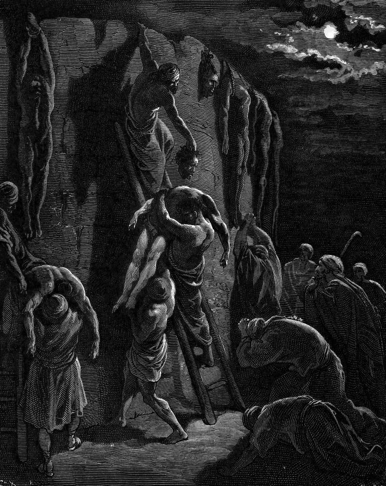

# Day 93: Of the Bodies

*Jabesh-Gileadites Recover the Bodies of Saul and His Sons. Gustave Doré · La Grande Bible de Tours, 1866.*

The Black Breviary, Book I, Burden. All 365 days: https://blackbreviary.app/llms/days.md

All night the men of Jabesh-gilead walked toward Beth-shan. The Philistines had found Saul and three of his sons dead on Mount Gilboa, cut off the king's head and fastened his body to the town wall. When the fighting men of a small place across the Jordan heard of it they got up, crossed in the dark, took the king and his sons down, burned them at home, buried the bones under a tree at Jabesh and fasted seven days.

Twenty chapters back, Nahash the Ammonite had besieged Jabesh and offered terms, the town's surrender on condition that he thrust out every man's right eye as a disgrace upon Israel. Saul, newly anointed and still coming in from the field behind his oxen, cut a yoke of them in pieces, sent the pieces through the tribes, raised an army and broke the siege in the last watch of the night.

By the time of the wall, heaven had finished with Saul. The spirit of the Lord had left him years before, and at the end he went to a medium at Endor because heaven no longer answered him. The men of Jabesh left heaven's verdict to heaven. They owed him that siege.

They paid at the highest price on offer, a march into enemy country for a king whose god had dropped him and whose army had broken on Gilboa. Saul had struck for them at the end of a night, and they answered with a night march of their own. By morning the wall at Beth-shan was bare.

Charge: Repay whoever stood by you, most of all once they fall.

Rite: Choose someone who helped you when it cost them, above all one others now run down. Today, where those others can hear, say {This one stood by me,} and tell exactly what they did for you.

Question: Whom do you owe for a rescue, and how much of it have you paid?

Closing: I pay my rescuers, and their disgrace buys no discount.

Sources quoted:
- dead on Mount Gilboa (1 Sam 31:8)
- fastened his body to the town wall (1 Sam 31:9–10)
- fasted seven days (1 Sam 31:11–13)
- as a disgrace upon Israel (1 Sam 11:2)
- broke the siege in the last watch of the night (1 Sam 11:5–11)
- because heaven no longer answered him (1 Sam 28:6–7)

