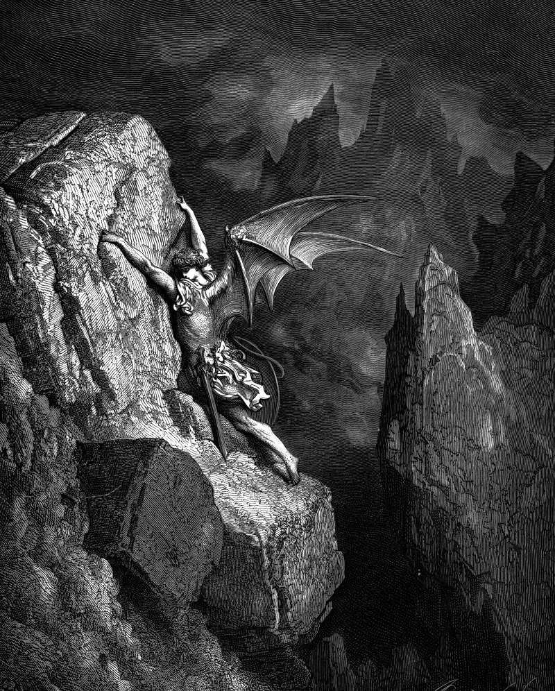

# Day 98: Of the Long Way

*Satan Crosses Chaos. Gustave Doré · Paradise Lost, Book II, 1866.*

The Black Breviary, Book I, Burden. All 365 days: https://blackbreviary.app/llms/days.md

The earth was without form and void, the second verse of Genesis says, in Hebrew two words that rhyme like a nursery chant for nothing at all, tohu and bohu. Darkness lay on the face of the deep. The waters parted on the second day and the dry land raised on the third are worked out of that material. In the seventeenth-century English retelling of the fall, Satan crosses the same blank alone, with his own wings for a road.

Isaiah has the god insist on the monopoly. He is the maker of all things, who stretched out the heavens alone and spread out the earth by himself, and he will give his glory to no other. In chapter forty-five he pronounces woe on whoever strives with his maker, the clay that asks the potter what he is making. The creed opens on the trade, maker of heaven and earth, and leaves the clay a shape to take and thanks to give.

Whoever makes something from a blank, a business from a bare idea or a book from an empty file, works the trade Isaiah's god said he worked alone, and works it without omnipotence, which makes the labor harder and the credit larger. The parable of the talents, which gave English its word for a gift, was preached as heaven's capital lent out to be returned with interest, so the credit for every made thing was owed to the lender before the thing was finished. Isaiah's god signed heaven and earth as his own and shared none of the glory, and by that rule the first page made from a blank carries one name at its foot, the maker's.

Charge: Take up the trade heaven claimed for itself alone.

Rite: Sit before a blank page or an empty file and say {Let there be something here.} aloud. Within the hour make the first piece of something that did not exist this morning, and sign it in full.

Question: What have you made that you were taught to credit to heaven?

Closing: Let the potter pronounce his woe, because my name is already on the work.

Sources quoted:
- Darkness lay on the face of the deep (Gen 1:2)
- stretched out the heavens alone (Isa 44:24)
- give his glory to no other (Isa 42:8)
- the clay that asks the potter what he is making (Isa 45:9)
- maker of heaven and earth (Nicene-Constantinopolitan Creed (381))
- returned with interest (Matt 25:27)

