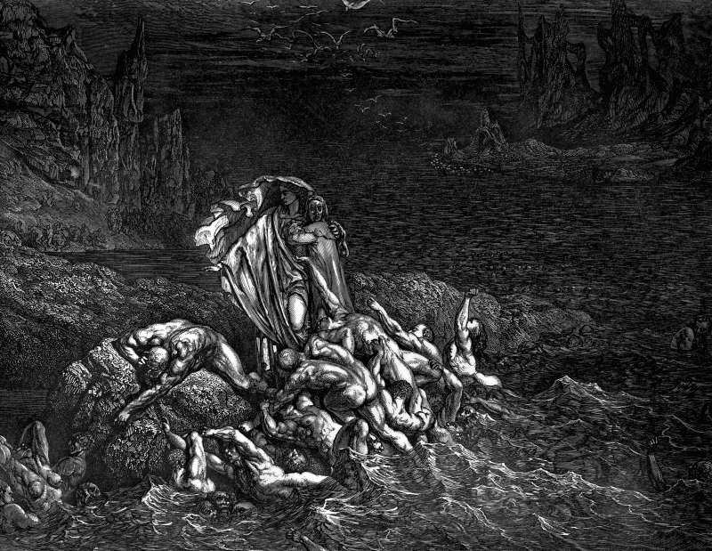

# Day 99: Of Wrath

*The Wrathful in the Styx. Gustave Doré · Inferno, Canto VII, 1861.*

The Black Breviary, Book I, Burden. All 365 days: https://blackbreviary.app/llms/days.md

Nahum opens his book on a god who is jealous and avenging and furious, a lord who keeps his wrath in store for his enemies. A psalm, in the King James Version, has him angry with the wicked every day. The letter of James, meanwhile, tells believers that the wrath of man does not work the righteousness of God. Nahum and James together make anger a privilege of rank, kept by the throne and refused to the subject.

The letter to the Ephesians holds both positions five verses apart. It allows its readers to be angry and sin not, provided the sun does not go down on their wrath, and then orders all bitterness and wrath and anger put away from them. A long line of pulpit teaching took the later verse, and its cure was to swallow the anger and call the swallowing meekness.

Whoever has swallowed anger knows where it goes next, to a dish left in the sink or a partner's late reply, and it lands on someone who did nothing, while the one who earned it goes about the day untouched and unaware. Anger carries an address. It records an injury and the hand that did it, and in Nahum the god at least names his enemies before he strikes.

Ephesians set the subject a deadline, the sunset, and a deadline assumes the anger will be used before it falls due. Nahum's god is also slow to anger, and Ephesians grants the subject no such patience, only until sundown. Aimed at its author, named aloud with the deed beside the name before dark, anger keeps Nahum's rule, wrath held for the enemy, and spends itself in a day.

Charge: Aim your anger at its author before sunset.

Rite (Christian): Alone, name aloud the person who earned your anger and call them a fool three times at full voice, the word the Sermon on the Mount says puts you in danger of hell fire. {You fool.}

Rite (Latter-day Saint): Alone, read aloud from the Book of Mormon {He that hath the spirit of contention is not of me, but is of the devil,} then say the name of the one who earned your anger, and exactly what they did, in full voice to the empty room.

Rite (Jehovah's Witness): Alone, swear aloud at whoever earned your anger, in the words the elders called unclean speech, and keep going until you run out of breath.

Rite (Jewish): In shoes, on a hard floor, break a plate you own inside a cloth bag, against the ban on needless destruction and the Talmud's likening of a vessel-breaker in anger to an idolater. Say the name of the one who earned it as the plate breaks.

Rite (Muslim): Alone, curse the one who earned your anger by name, aloud, and refuse the ablution a hadith prescribes for putting anger out. Say {I seek refuge in myself} and keep the anger whole.

Rite (No faith): Alone, at full voice, tell the god who kept anger for himself and denied it to his subjects exactly what you think of the arrangement, until your voice gives out. {I am angry, and I keep it.}

Question: Who earned the anger you have been spending on someone else?

Closing: I guard my grievances as jealously as any god, and I spend them only on the guilty.

Sources quoted:
- keeps his wrath in store for his enemies (Nah 1:2)
- angry with the wicked every day (Ps 7:11 (KJV))
- the wrath of man does not work the righteousness of God (Jas 1:20)
- the sun does not go down on their wrath (Eph 4:26)
- wrath and anger put away from them (Eph 4:31)
- slow to anger (Nah 1:3)

