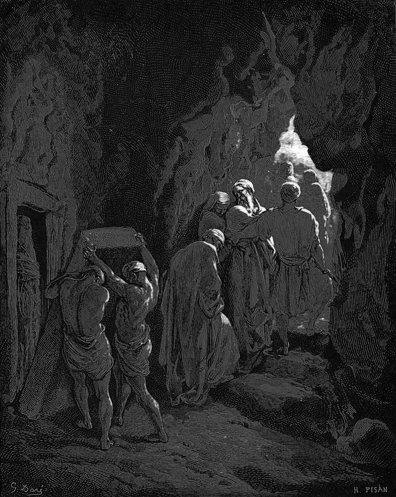

# Day 103: Of Paying in Full

*The Burial of Sarah. Gustave Doré · La Grande Bible de Tours, 1866.*

The Black Breviary, Book I, Burden. All 365 days: https://blackbreviary.app/llms/days.md

Ephron the Hittite offered Abraham the field and the cave of Machpelah as a gift, in the hearing of everyone who went in at the city gate, so that he could bury Sarah. Abraham, a resident alien at Hebron, refused the gift and insisted on paying. Ephron named the price the way a man waves a matter aside, land worth four hundred shekels of silver, what is that between friends, and Abraham weighed out the whole sum on the spot at the merchants' rate. Genesis spends a chapter on the bargaining and a single verse on the burial.

The field and the cave were made sure to Abraham as a possession before every witness at the gate. Ground accepted as a gift stays under the giver's goodwill for as long as he cares to remember the giving, and a grave on borrowed ground is a grave the giver's sons can order the next generation to leave. The silver bought title instead. Isaac and Rebekah were buried there in time, and Jacob was carried up out of Egypt to lie beside Leah, on land nobody could say had been lent.

A gift that comes back later as a debt in another currency was a loan from the start. The parents' deposit on a house that comes with a say in the marriage is one, and so is a congregation's help through a bad year that falls due in attendance and silence. Paid off at its full price, such a gift stops collecting, and the next holiday at the parents' house becomes a visit instead of an installment.

Charge: Pay what it costs and own what you stand on.

Rite: Name one gift or favor you are still repaying in visits, silence or deference. Return it, or pay its fair price in money to the giver, saying aloud what the payment settles.

Question: Which gift are you still repaying in obedience, and what would it cost to clear it outright?

Closing: Keep your gift. I would rather pay a merchant's rate than owe a benefactor.

Sources quoted:
- everyone who went in at the city gate (Gen 23:10–11)
- what is that between friends (Gen 23:15)
- at the merchants' rate (Gen 23:16)
- a single verse on the burial (Gen 23:19)
- made sure to Abraham as a possession (Gen 23:17–18)
- Isaac and Rebekah were buried there in time (Gen 49:31)
- carried up out of Egypt (Gen 50:13)

