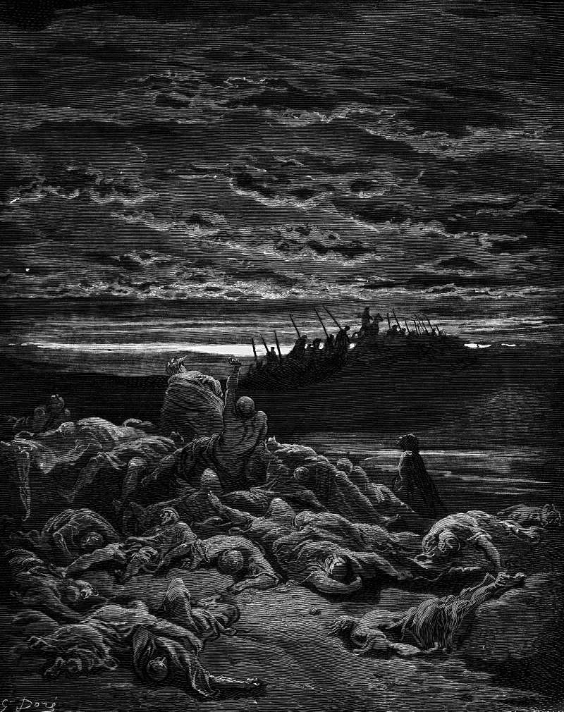

# Day 104: Of the Bramble

*The Death of Gideon's Sons. Gustave Doré · La Grande Bible de Tours, 1866.*

The Black Breviary, Book I, Burden. All 365 days: https://blackbreviary.app/llms/days.md

Seventy pieces of silver from the temple of Baal-berith paid for the killing. Abimelech, Gideon's son by a concubine in Shechem, hired idle and reckless men with the money, went to his father's house at Ophrah and killed his seventy half-brothers on one stone. The youngest, Jotham, escaped by hiding, and the men of Shechem made the killer their king.

Jotham answered from the top of Mount Gerizim with a fable. The trees went out to anoint a king over themselves. The olive refused, since it would have to leave the oil by which, it says, God and man are honored, and the fig would not leave its sweetness, and the vine would not leave the wine that cheers God and man. Only the bramble accepted, and it offered the trees its shade, with fire to devour the cedars of Lebanon if they refused.

Every tree with a yield of its own turned the crown down and named what ruling would cost it. Gideon, whom the fable has in view, had told Israel I will not rule over you, and it was his seventy sons who were killed for the vacancy. The bramble had nothing to lose by accepting, and its first speech as king was a threat. The fable charges Shechem for crowning the bramble and prices the refusal, since when the fruitful decline, someone with nothing to lose takes the crown. Three years on, the fire came out of Abimelech as Jotham had said, about a thousand men and women of Shechem burned in the stronghold of their own god's temple. Offices still go looking among the fruitful first, the church calling or the promotion that lifts the best hand off the bench. An olive that accepts spends its season swaying over the other trees, and its oil stays in the fruit.

Charge: Refuse the office that would cost you your own harvest.

Rite (Christian): Write to whoever runs your church's committees or rotas and resign one post, or refuse the next one offered, in a single sentence. Eat a fig slowly while it sends, then say {I keep my fruit.}

Rite (Protestant): Step down today, in a one-line message, from one church or volunteer post, the board seat, the rota or the youth group. Then eat a bunch of grapes slowly, the fruit of the vine that refused. {I keep my fruit.}

Rite (Latter-day Saint): Ask your bishop today, in one written sentence, to release you from your current calling, or tell him you will decline the next. Then eat a handful of olives slowly. {I keep my fruit.}

Rite (Jehovah's Witness): Write to the elders, in one sentence, that you will take no further assignment at the Kingdom Hall, no talk and no cleaning shift. Eat a fig slowly while it sends. {I keep my fruit.}

Rite (Jewish): Decline today, in one written sentence, a seat on a synagogue board, a committee or a rota. Then dip bread in olive oil, the oil the olive says honors God and man, and eat it. {I keep my fruit.}

Rite (Muslim): Decline today, in one written sentence, a mosque committee, a family duty or an extra post at work that would take your evenings. Then eat figs and olives, the two fruits sworn by in Surat al-Tin. {I keep my fruit.}

Rite (No faith): Turn down today, in one written sentence, a committee seat, an extra duty or a promotion that would pull you off your own work. Buy a potted fig, olive or vine and set it where you work. {I keep my fruit.}

Question: Which post you were offered would eat the work only you can do, and what will you grow in the hours you keep?

Closing: Let the brambles have the crowns and the cedars their fire. I have oil to press.

Sources quoted:
- from the temple of Baal-berith (Judg 9:4)
- killed his seventy half-brothers on one stone (Judg 9:5)
- from the top of Mount Gerizim (Judg 9:7)
- by which, it says, God and man are honored (Judg 9:9)
- the wine that cheers God and man (Judg 9:13)
- offered the trees its shade (Judg 9:15)
- I will not rule over you (Judg 8:22–23; 9:5)
- the fire came out of Abimelech as Jotham had said (Judg 9:20, 9:22)
- burned in the stronghold of their own god's temple (Judg 9:46–49)

