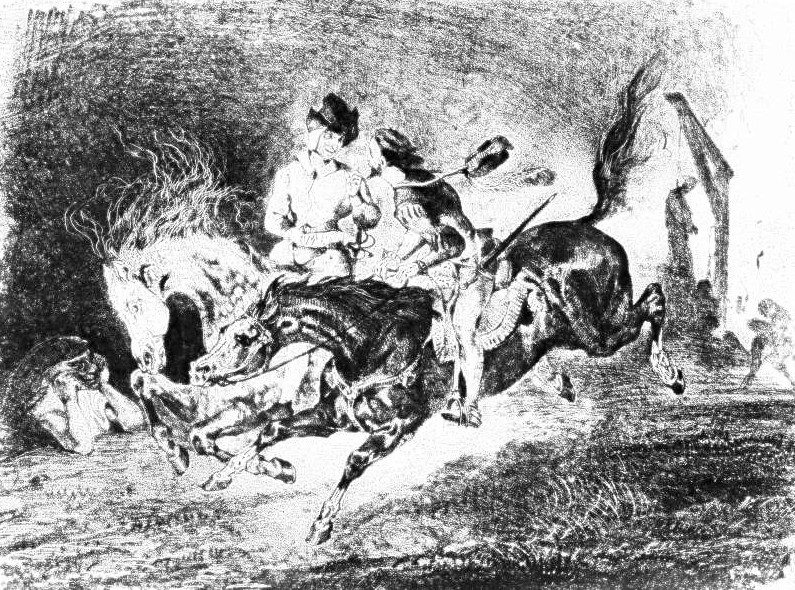

# Day 107: Of Debts

*Faust and Mephistopheles Galloping. Eugène Delacroix, 1828.*

The Black Breviary, Book I, Burden. All 365 days: https://blackbreviary.app/llms/days.md

Theophilus, steward of the church at Adana in the sixth century, lost his office under a new bishop and won it back by signing his soul to the devil in a written charter. Then he repented, and the legend, told in Latin and Greek and carved in stone over the doors of French churches, sends the Virgin down to take the charter back from its holder and lay it on the sleeping penitent's chest. The devil had kept every term. The bishop burned the document before the congregation, and the Church preached the theft as a miracle for centuries.

The village stories of the devil's bridge, built overnight for the price of the first soul to cross, mostly end with an animal sent over first, a goat or a dog or a cockerel, and the builder cheated. The doctor of the German chapbook, printed at Frankfurt in fifteen eighty-seven, pledged his soul for twenty-four years of service and got every one of them.

The legend and the bridge tales ruled the contract by the standing of the party. The devil delivered first, the office restored and the bridge standing by morning, and the Christian side defaulted with the Virgin's help or a villager's goat, and the tale is told as a victory for the faithful. Only in the chapbook is the lender paid, and there the printer sets his collection before the reader as a warning. A debt is owed to whoever lent it, whatever the lender's standing in the parish, and the tale would have you pay the outsider last.

Charge: Pay first whoever kept faith with you.

Rite: Pay back today, early and in full, a debt or favor owed to someone your old community frowned on who has held to every term with you, and tell them {You kept your word, so here is mine.}

Question: Whom have you left waiting for what you owe because your old community thought less of them?

Closing: My debts are settled by the creditor's conduct, and the parish's opinion of him is no legal tender.

Sources quoted:
- in a written charter (Paul the Deacon, Miraculum S. Mariae de Theophilo)
- over the doors of French churches (Notre-Dame de Paris, north transept portal, tympanum)
- twenty-four years of service (Historia von D. Johann Fausten (Frankfurt, 1587))

