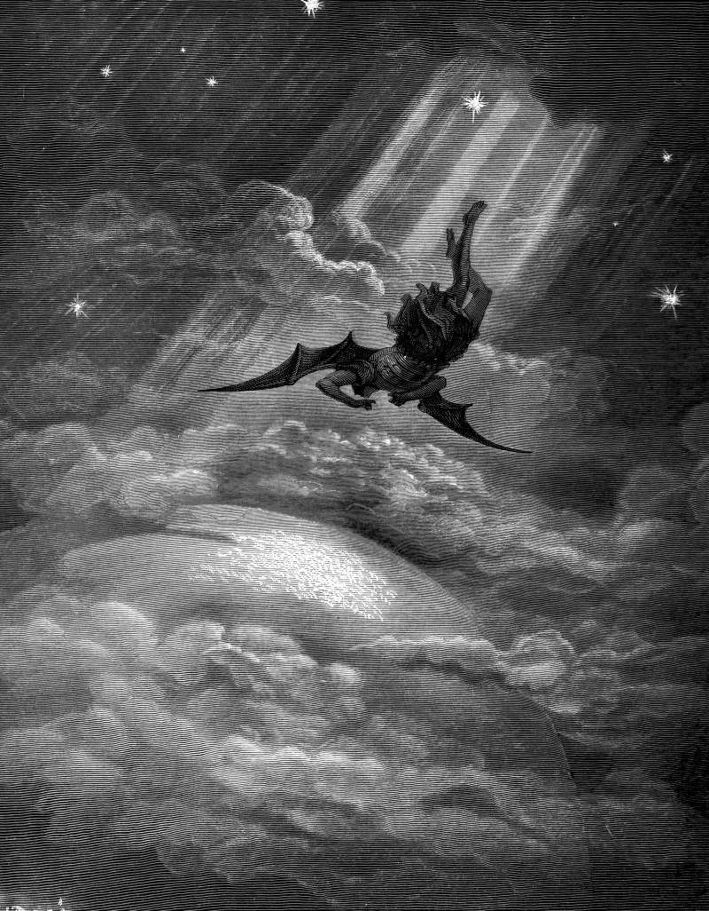

# Day 112: Of Height

*Satan Flies Toward Earth. Gustave Doré · Paradise Lost, Book III, 1866.*

The Black Breviary, Book I, Burden. All 365 days: https://blackbreviary.app/llms/days.md

Abram and Lot came up out of Egypt with more herds than the land could carry, and on the high ground between Bethel and Ai their herdsmen quarreled over pasture. Abram gave his nephew the choice of direction. Lot lifted up his eyes and saw the whole plain of the Jordan well watered everywhere, like the garden of the Lord, and chose it for himself, and the narrator sets its wicked men down two verses after the choice.

Once Lot had gone, the god told Abram to do what Lot had done. Lift up your eyes, he said, and look from the place where you stand, north and south and east and west, for all the land you see I will give to you and your seed for ever. It is the same raised eye over the same country. The chapter darkens the look in the man who took and blesses it in the man being handed the land, and the tempter of Matthew offers the same view from an exceedingly high mountain, every kingdom of the world.

The god who promised Abram every acre his eye could reach later sent him up a mountain in the land of Moriah to lay the promised seed on an altar, and the promise was renewed because he did it. The tempter named his price, a single bow, before the kingdoms had cleared from sight. Lot took his view from his uncle's open hand and owed no god for it, whatever the plain cost him later. A rooftop above your own city lays the country out the way the Jordan plain lay before him, and whoever looks at it from there owes the view to nobody's gift.

Charge: Look down on your city from a height nobody gave you.

Rite: Climb to the highest place above your town you can reach, a rooftop, a terrace or a hill. Sit with the whole town below you for an hour.

Question: Which height near you have you never climbed because no one sent you up it?

Closing: Abraham paid for his view with a knife raised over his son, and I paid for mine with the stairs.

Sources quoted:
- their herdsmen quarreled over pasture (Gen 13:6–7)
- chose it for himself (Gen 13:10–11)
- sets its wicked men down (Gen 13:13)
- north and south and east and west (Gen 13:14–15)
- an exceedingly high mountain (Matt 4:8)
- a mountain in the land of Moriah (Gen 22:2)
- the promise was renewed because he did it (Gen 22:16–17)
- a single bow (Matt 4:9)

