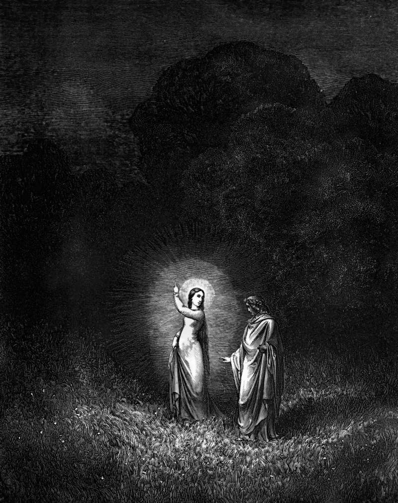

# Day 114: Of the Beloved

*Beatrice Sends the Guide. Gustave Doré · Inferno, Canto II, 1861.*

The Black Breviary, Book I, Burden. All 365 days: https://blackbreviary.app/llms/days.md

And it came to pass, as Peter passed throughout all quarters, he came down also to the saints which dwelt at Lydda. And there he found a certain man named Aeneas, which had kept his bed eight years, and was sick of the palsy. And Peter said unto him, Aeneas, Jesus Christ maketh thee whole, arise, and make thy bed. And he arose immediately. And all that dwelt at Lydda and Saron saw him, and turned to the Lord.

Now there was at Joppa a certain disciple named Tabitha, which by interpretation is called Dorcas, and this woman was full of good works and almsdeeds which she did. And it came to pass in those days that she was sick, and died, and when they had washed her, they laid her in an upper chamber. And forasmuch as Lydda was nigh to Joppa, and the disciples had heard that Peter was there, they sent unto him two men, desiring him that he would not delay to come to them.

Then Peter arose and went with them. When he was come, they brought him into the upper chamber, and all the widows stood by him weeping, and shewing the coats and garments which Dorcas made, while she was with them. But Peter put them all forth, and kneeled down, and prayed, and turning him to the body said, Tabitha, arise. And she opened her eyes, and when she saw Peter, she sat up. He gave her his hand, and lifted her up, and when he had called the saints and widows, presented her alive. It was known throughout all Joppa, and many believed in the Lord. And it came to pass, that he tarried many days in Joppa with one Simon a tanner.

Charge: Wear your dead to rags.

Rite: Take one thing a dead person made or gave you, a coat, a tool, a pen, and use it for its job today and every day this week. Say their name aloud as you start.

Question: What did someone who died give you that you keep too carefully to use?

Closing: What my dead made for me goes on my back and out into the weather.

Sources quoted:
- kept his bed eight years (Acts 9:33)
- turned to the Lord (Acts 9:35)
- full of good works and almsdeeds which she did (Acts 9:36)
- laid her in an upper chamber (Acts 9:37)
- they sent unto him two men (Acts 9:38)
- shewing the coats and garments which Dorcas made (Acts 9:39)
- said, Tabitha, arise (Acts 9:40)
- presented her alive (Acts 9:41)
- many believed in the Lord (Acts 9:42)
- one Simon a tanner (Acts 9:43)

