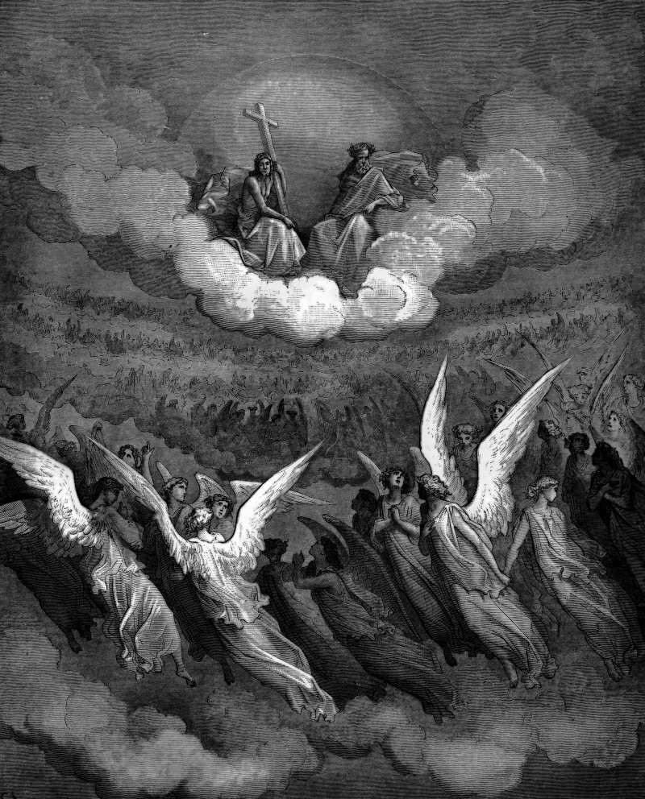

# Day 115: Of Hosannas

*Heaven Sings Hosannas. Gustave Doré · Paradise Lost, Book III, 1866.*

The Black Breviary, Book I, Burden. All 365 days: https://blackbreviary.app/llms/days.md

Twenty-four elders cast their crowns before the throne in Revelation, four creatures covered in eyes cry holy without rest day and night, and a hundred and forty-four thousand sing a song that no one else is able to learn. When the martyrs under the altar cry how long, they are handed white robes and told to rest a little while longer.

The Hebrew name of the book of Psalms is Tehillim, praises, and among its hundred and fifty the compilers kept one that never turns. The eighty-eighth opens by calling the god the God of my salvation and gets no answer in anything that follows, the singer counted with those who go down to the pit, his eye wasted with affliction, crying to a god who hides his face, and it ends with lover and friend put far away and darkness for company. Many of the other laments in the book break off into thanks before the end.

The command to give thanks now comes down without its throne, to the notebook of three good things written every night and the affirmation recited to the bathroom mirror, and it presses hardest on the bad year, when the death, the layoff or the diagnosis is to be counted a blessing in disguise. The superscription gives the eighty-eighth psalm to a temple choir, the sons of Korah, and the book called praises has carried it for over twenty centuries without a line of it softened. A complaint with that pedigree needs no one's permission to say what it says.

Charge: Withhold your thanks from the year that hurt you.

Rite: Buy a printed thank-you card. Inside, write your curse on the thing you were told to be thankful for, in the plainest words you have. Read it aloud alone at full voice, then mail it to yourself and leave it sealed.

Question: Which loss did someone ask you to see as a gift, and what name does it deserve?

Closing: Heaven kept its martyrs waiting in white robes, so whoever calls my loss a gift can wait as long for my gratitude.

Sources quoted:
- cast their crowns before the throne (Rev 4:10)
- without rest day and night (Rev 4:8)
- no one else is able to learn (Rev 14:3)
- told to rest a little while longer (Rev 6:9–11)
- those who go down to the pit (Ps 88:4)
- darkness for company (Ps 88:18)
- break off into thanks before the end (Ps 13:5–6; 22:22–31)
- gives the eighty-eighth psalm to a temple choir (Ps 88, superscription)

