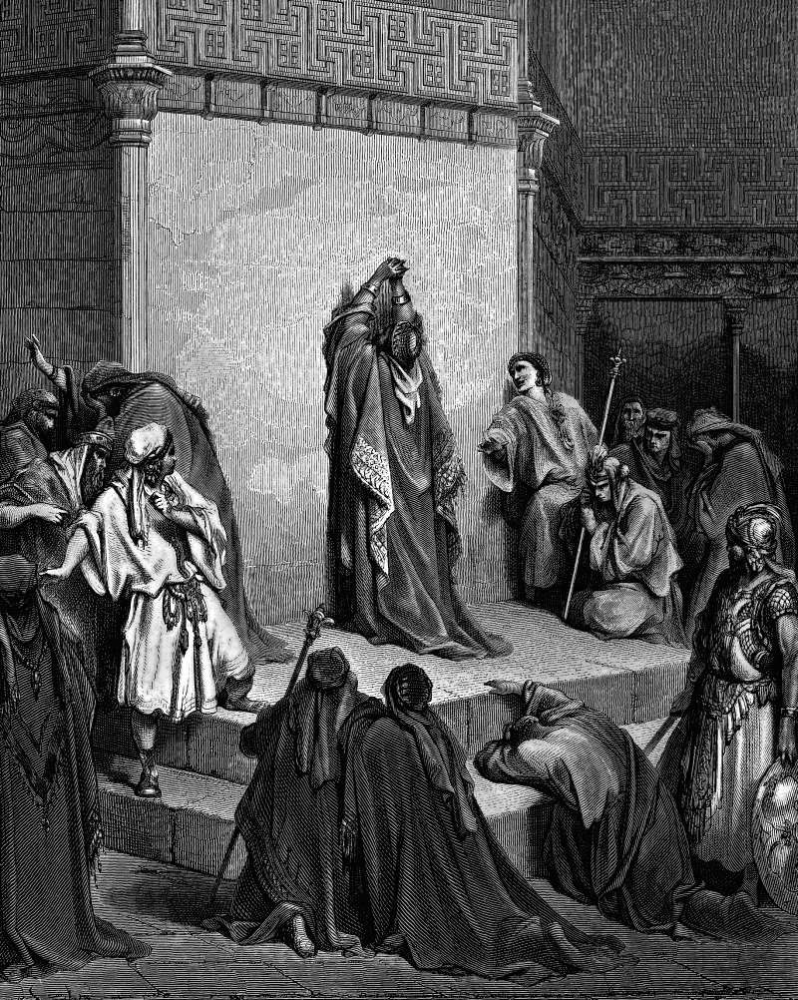

# Day 117: Of Sons

*David Mourns the Death of Absalom. Gustave Doré · La Grande Bible de Tours, 1866.*

The Black Breviary, Book I, Burden. All 365 days: https://blackbreviary.app/llms/days.md

When Amnon raped his half-sister Tamar, the Hebrew of Samuel says only that King David was very angry. The Greek translation, and a scroll of Samuel found at Qumran, carry a clause the Hebrew lacks, that he would not grieve his son Amnon, because he loved him, since he was his firstborn. The king's love for the rapist was the whole of the sentence passed. Tamar stayed desolate in Absalom's house.

Absalom waited two full years and had Amnon struck down at a sheep-shearing feast, then fled to his mother's father in Geshur for three years. The chapter keeps the king's grief, mourning for his son every day, and when he was comforted concerning Amnon, seeing he was dead, his soul longed for Absalom, who had killed him. Brought home at last, Absalom was kept from his father's face for two more years and had Joab's barley set on fire to win an audience, and the kiss he got there did not keep him from raising an army.

David passed no sentence on the son he loved, so his other son passed it at a feast, and the story runs on to Absalom caught in an oak and his father weeping over the gate. Love that withholds judgment hands the judgment to whoever is angriest in the house. The counsel Absalom gave his sister, hold your peace, he is your brother, is the one the wronged still hear under the name of forgiveness. Absalom's way of settling the harm and David's way of leaving it unsettled ended in the same grief. A harm named aloud at home, with its price said to the one who did it, costs a family less than either.

Charge: Mourn the relative who harmed you, and stop excusing them.

Rite: Say aloud, alone, the harm a family member did you and what it has cost them with you. Then withdraw one thing today, the visit, the call or the gift, and say {You did this, and this is what it cost you.}

Question: Which relative do you grieve and resent at once, and what have they got coming?

Closing: Forgiveness that asks me to hold my peace is Absalom's hush to Tamar, and I have read the chapters that follow it.

Sources quoted:
- was very angry (2 Sam 13:21)
- because he loved him, since he was his firstborn (2 Sam 13:21 (LXX; 4QSam a))
- Tamar stayed desolate in Absalom's house (2 Sam 13:20)
- had Amnon struck down at a sheep-shearing feast (2 Sam 13:23–29)
- his soul longed for Absalom (2 Sam 13:37–39)
- kept from his father's face for two more years (2 Sam 14:24, 28)
- caught in an oak (2 Sam 18:9–15)
- his father weeping over the gate (2 Sam 18:33)
- hold your peace, he is your brother (2 Sam 13:20)

