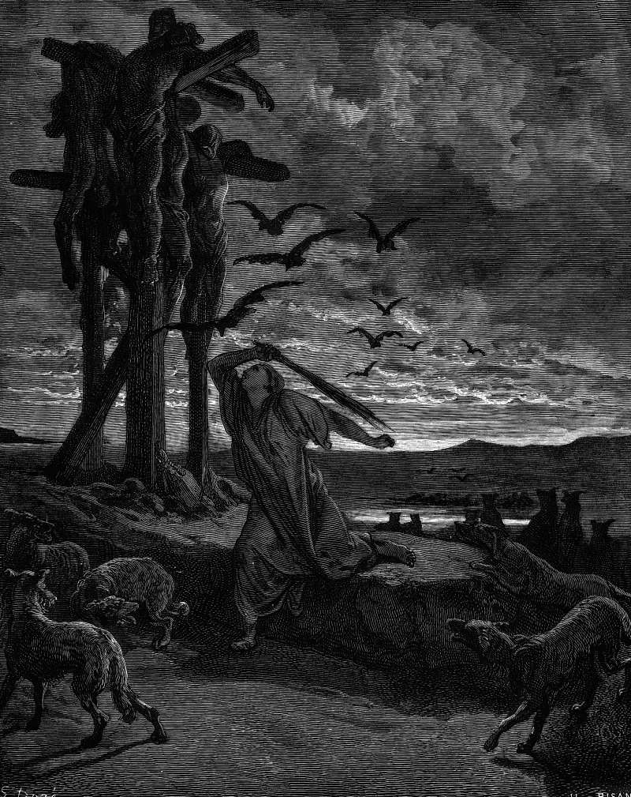

# Day 121: Of Rizpah

*Rizpah’s Kindness toward the Dead. Gustave Doré · La Grande Bible de Tours, 1866.*

The Black Breviary, Book I, Burden. All 365 days: https://blackbreviary.app/llms/days.md

A famine had lasted three years in David's reign. When he inquired of the god, the answer came that it was for Saul and his bloody house, because Saul had put Gibeonites to death in breach of an oath. The Gibeonites asked for seven of Saul's descendants, and David handed them over, among them Armoni and Mephibosheth, the two sons Rizpah had borne to Saul. They were hanged on the hill before the god in the first days of the barley harvest and left where they hung.

Rizpah spread sackcloth on the rock beneath them and stayed from the beginning of harvest until rain fell on the bodies, beating off the birds by day and the wild beasts by night. Nobody in the chapter asks her to, and she stays.

The hangings settled nothing. The rain came with Rizpah still on the rock. Then David was told what Rizpah had done, and he went and fetched the bones of Saul and Jonathan from the men of Jabesh-gilead, had the bones of the hanged gathered, and laid Saul and Jonathan in the tomb of Saul's father, and only after that, the text says, the god was entreated for the land.

A woman with no office and no petition kept watch over what the king had given away, and a king who had answered a god with a gallows answered her with a burial. Grief that goes home leaves the dead to the birds, and the bones of her sons came down off the hill because Rizpah stayed on the rock.

Charge: Stay in sight of power until it answers you.

Rite: Lay on a cloth outdoors the photo or name of someone a church or state treated as nothing, and sit by it an hour. Write {I am still here, and so are they.} on the cloth, say it aloud, and tie it to a railing outside that church or office.

Question: Whose wrong would you sit beside in public until the people responsible came out to deal with it?

Closing: A god who hangs seven sons for a famine and answers only after a woman has shamed a king into a burial gets no harvest offering from me.

Sources quoted:
- Saul and his bloody house (2 Sam 21:1)
- in breach of an oath (2 Sam 21:2; Josh 9:15)
- the two sons Rizpah had borne to Saul (2 Sam 21:8)
- the first days of the barley harvest (2 Sam 21:6, 9)
- the wild beasts by night (2 Sam 21:10)
- David was told what Rizpah had done (2 Sam 21:11)
- the god was entreated for the land (2 Sam 21:12–14)

