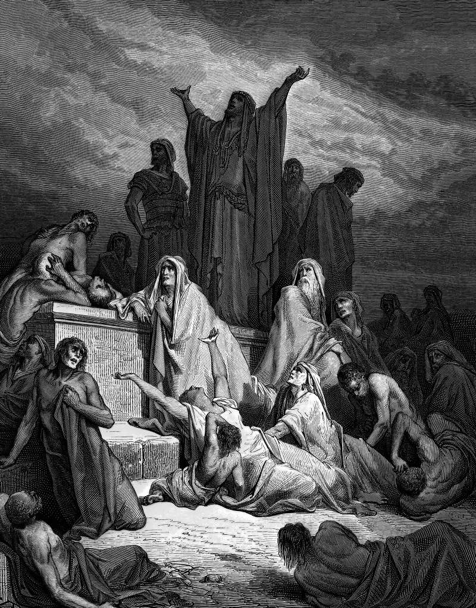

# Day 125: Of the Census

*The Plague of Jerusalem. Gustave Doré · La Grande Bible de Tours, 1866.*

The Black Breviary, Book II, Refusal. All 365 days: https://blackbreviary.app/llms/days.md

The anger of the Lord was kindled against Israel, and the second book of Samuel has him move David to go and count the people. Joab protested, the count took nine months and twenty days, and when it was finished David's heart struck him. The prophet Gad offered famine, flight or plague, the king chose the god's hand, and seventy thousand men died between Dan and Beersheba, none of whom had ordered the count.

The impulse in this story came from outside the man, and the book names its owner. A later historian could not let the admission stand. When Chronicles retells the census, generations later, the anger of the Lord is gone and an adversary rises to provoke the king, so that the figure who would grow into the devil enters the record of Israel's kings as an editor's correction to the god's authorship. In both books the god halts the angel at a threshing floor, where his temple would later stand, and David asks him what the sheep have done.

A child taught from the Sermon on the Mount that a lustful look is adultery already done in the heart learns to search every thought that arrives, the obscene picture in the middle of a prayer and the flash of hatred at a funeral, as though each came signed by the one who had it. A faith that has you confess the thought beside the deed is less honest than its own older telling. Your acts carry your name. The thought that walks in during the hymn was never yours to confess, and every hour spent confessing it is taken from the deeds you will answer for.

Charge: Answer for what you did, never for what arrived.

Rite (Christian): Write out the thought you most often confessed or prayed against, sign it with the god's name as its author, as the second book of Samuel signs the census, and burn the page in the sink saying {Return to sender.}

Rite (Catholic): Copy out an examination of conscience, cross out every line that asks about thoughts and desires, keep the lines about deeds, and read the kept lines aloud, ending {I answer for my hands.}

Rite (Latter-day Saint): Watch a film rated R all the way through, the rating your youth leaders told you to refuse, and each time a thought arrives that you were taught to confess, say aloud {That one came unasked.}

Rite (Jewish): Count the people in your household or at your table aloud by number, one, two, three, the direct head count the Talmud forbids and ties to David's plague, and finish with {The count is mine and the plague was his.}

Rite (Muslim): Say aloud the thought you were taught to call a prompting of Shaytan, without the formula of refuge you were taught to say first, and follow it with {It came unasked and I owe nothing for it.}

Rite (No faith): Tell someone you trust the ugliest thought that crossed your mind this week, then name one thing you did this week that you will answer for. {The second one is mine.}

Question: Which guilt do you still carry for an impulse you never chose to have?

Closing: The god signed the census in the first verse, and I have stopped confessing his handwriting.

Sources quoted:
- move David to go and count the people (2 Sam 24:1)
- nine months and twenty days (2 Sam 24:8–10)
- famine, flight or plague (2 Sam 24:13–14)
- between Dan and Beersheba (2 Sam 24:15)
- an adversary rises to provoke the king (1 Chr 21:1)
- where his temple would later stand (2 Sam 24:16–18; 2 Chr 3:1)
- what the sheep have done (2 Sam 24:17)
- adultery already done in the heart (Matt 5:27–28)

