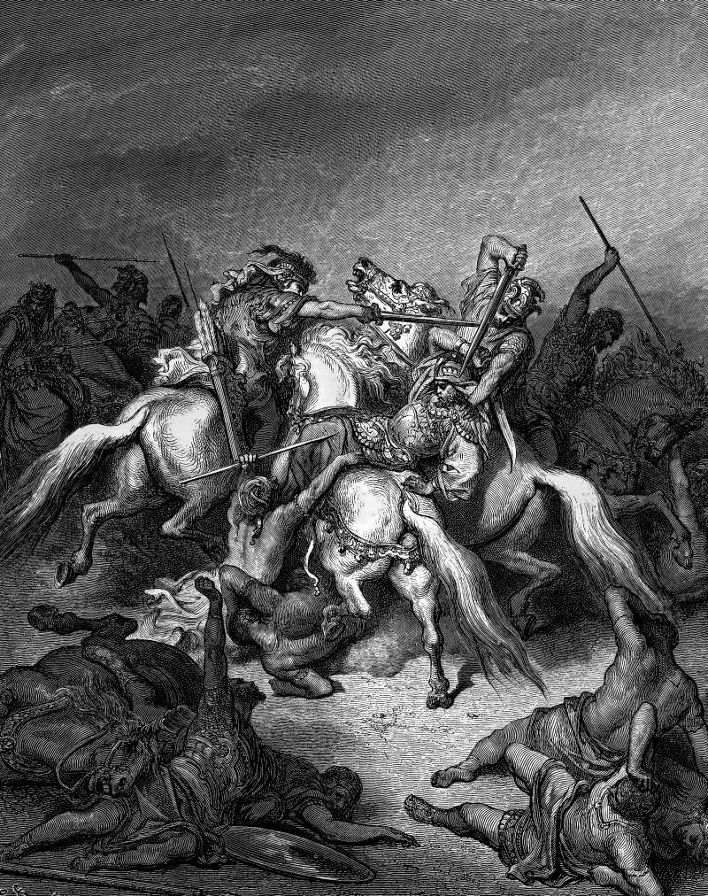

# Day 126: Of Allies

*Abishai Saves David's Life. Gustave Doré · La Grande Bible de Tours, 1866.*

The Black Breviary, Book II, Refusal. All 365 days: https://blackbreviary.app/llms/days.md

A Philistine of the giants' line meant to kill David, who had gone down to fight the Philistines one more time and grown faint. The giant's spearhead weighed three hundred shekels of bronze, and he wore a new sword. The book gives the rescue a single sentence. Abishai, David's nephew, came to his help and struck the Philistine dead, and afterward David's men swore that the king would never again go out with them to battle, lest he put out the lamp of Israel.

Abishai had volunteered before. When David asked in the wilderness who would go down with him by night into Saul's camp, Abishai alone answered, and standing over the sleeping king he begged leave to pin him to the ground with one thrust of a spear. When Shimei cursed David on the road, Abishai offered to go over and take off his head, and when Shimei came back over the Jordan, Abishai asked again for his death. David refused him each time he asked, and on the road he asked what he had to do with the sons of Zeruiah, the brothers he had called too hard for him after Abner's burial. The hardness he complained of is the same thing that took Abishai into the camp at night and down to a fainting king.

A family sorts its members by how easy they are to have at the table, and the record of one hard man runs against the sort. David rebuked Abishai three times and kept him, and when the giant came, the man who had begged to spear a sleeping king did the one thing the pleasant could not, and spent his hardness on David's side.

Charge: Reward the difficult friend who turned up.

Rite: Do for the friend who stood by you while hard to like the one job they would never ask of anyone, a shelf put up, a car cleaned or a form filled in, then tell them in one sentence what they did that earned it.

Question: What did the hardest of your friends do for you that the pleasant ones never did?

Closing: Pleasant company has never once pulled a giant off me, and my debts are paid to those who did.

Sources quoted:
- three hundred shekels of bronze (2 Sam 21:16)
- put out the lamp of Israel (2 Sam 21:15–17)
- Abishai alone answered (1 Sam 26:6)
- with one thrust of a spear (1 Sam 26:8)
- take off his head (2 Sam 16:5–9)
- what he had to do with the sons of Zeruiah (2 Sam 16:10; 1 Chr 2:16)
- after Abner's burial (2 Sam 3:31–39)

